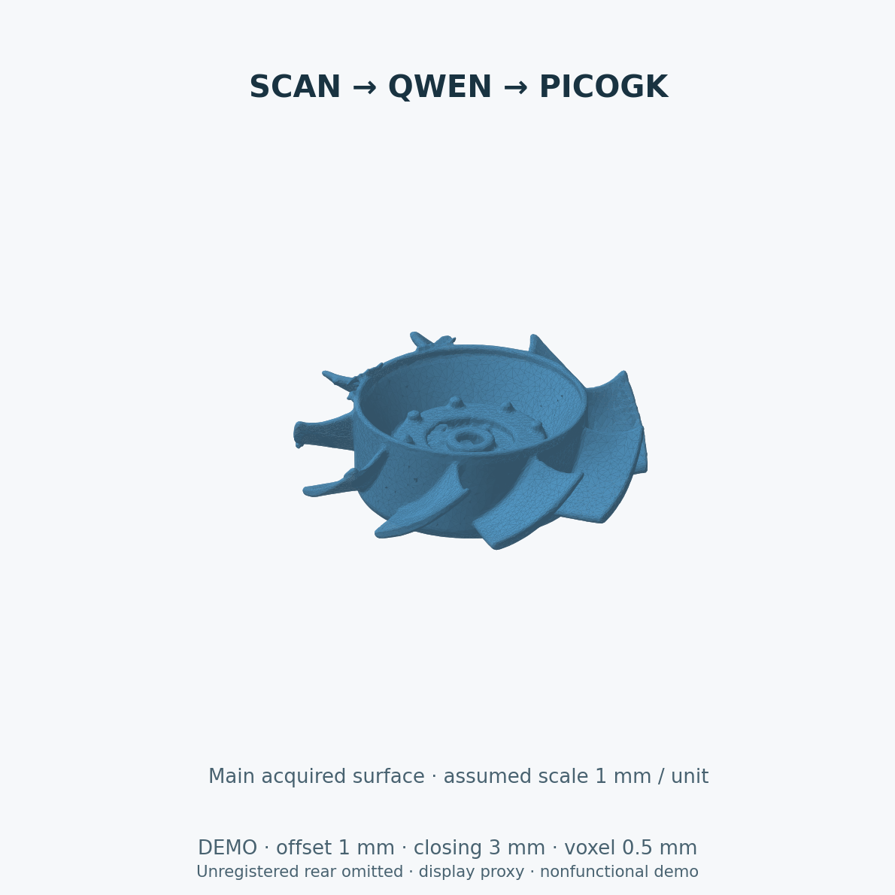
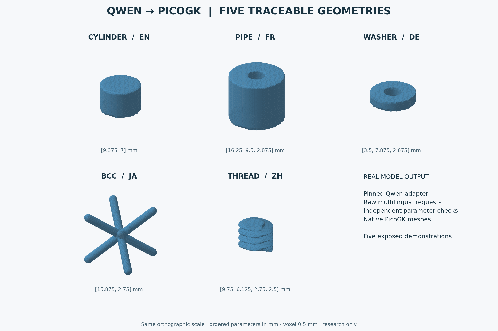
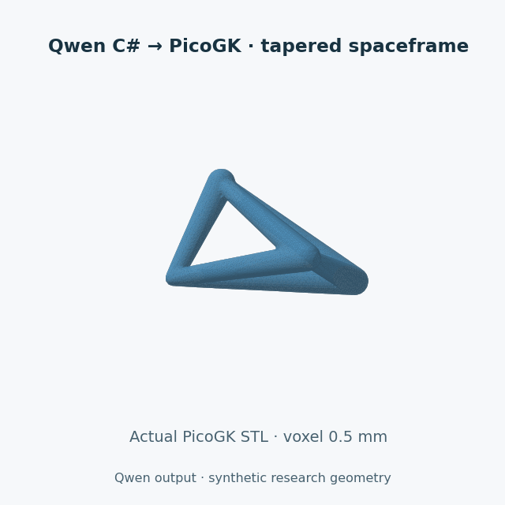
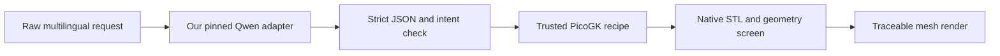

# Qwen PicoGK — bounded multilingual planning

An experimental **Qwen2.5-Coder-1.5B MLX LoRA adapter** for small synthetic
PicoGK parameter plans in English, French, German, Japanese and Chinese.
The supported-syntax final test passes **54/60**, versus **12/60** for the
retained earlier adapter on the same requests. Original exported material is
**Apache-2.0**. This independent repository contains no measured Porsche parts.

The useful contribution is a small, inspectable integration: explicit units
and radial roles, strict JSON, independent numeric intent checks, native
reference screens, failure records and uncertainty handling. It is not a
general CAD assistant or a manufacturing qualification system.



Actual PicoGK result from the [scan demonstration](docs/OBJ_TO_STL_DEMO.md),
shown through a display proxy. Qwen proposes tool plans; trusted C# produces
the geometry. Scale is assumed and the unregistered rear is omitted.
This is a nonfunctional demonstration, without metal-print or rotation qualification.
[Image provenance and reuse status](docs/visuals/scan-demo/fan-preview.json).

A separate [AM C# training study](am-code/README.md) publishes the requested
150-pair corpus, 64 native-validated corrective teachers, prompt-style
augmentation, portable guards and full rejected-course evidence. All nine
completed 1.5B, 7B, 14B and 32B courses remain rejected; a fresh 32B course
(010) is registered and running, with no result recorded at the snapshot.
No AM C# adapter is qualified or made the default. Large experiment artifacts
are inventoried as release assets, with local-path redaction and original/public
hash bindings.

A separate [PicoGK DfAM code corpus](docs/DFAM_CODE_CORPUS.md) is in progress:
4 of 150 planned examples. All four pass strict isolated native verification,
which now also measures wall thickness on the mesh and checks
self-intersections with exact predicates; training assembly still requires
the complete corpus. A [physics evidence plan](docs/PHYSICS_EVIDENCE_PLAN.md)
reviews seven open-source AM simulation and geometry projects and schedules
process and part-scale studies. Its first [process simulations](docs/PROCESS_SIMULATION.md)
run AdditiveFOAM in a pinned container. Against three NIST AM-Bench cases,
the calibrated tutorial reproduces cross-section width within 6 %. Its
melt-pool length is 9 to 36 % short, which is recorded rather than tuned
away. A 316L sweep is published as an uncalibrated trend. The
[part-scale chain](docs/PART_SCALE_SIMULATION.md) now runs verified corpus
geometry in a pinned adamantine image, and its heat balance closes at 0.5 mm
cells.






[Animated examples and a more complex C# probe](docs/SCAN_TO_PICOGK.md)
show both an admitted nonplanar tapered truss and a rejected K16-study
diffuser request. This text adapter does not accept or reconstruct raw scans.

A separate [OBJ-to-STL demonstration chain](docs/OBJ_TO_STL_DEMO.md) now uses
a dedicated tool-planning adapter, independent scan analysis, reconstruction
algorithms and a trusted PicoGK host. The model proposes a bounded plan from
typed features; geometry checks control STL delivery. This addition does not
replace the original planner or its benchmark, and it does not qualify a
metal part for manufacture.

The current scan chain adds [PyMesh exact cleanup and native intersection
auditing](docs/PYMESH_SCAN_RECONSTRUCTION.md), with source correspondence,
surface-preservation checks and a separately pinned offline runtime.

The [traceable gallery](docs/visuals/README.md) contains five real model calls,
their raw responses, native PicoGK STL files and mesh renders. The diagrams
in [architecture and evidence flow](docs/ARCHITECTURE.md) document the system.



## Quick start on Apple silicon

Python **3.12** and the pinned MLX runtime are required for inference. Linux CI
checks contracts/data only. The adapter is MLX format, not a PEFT checkpoint.

```sh
git clone https://github.com/cluster2600/qwen-picogk.git
cd qwen-picogk
python3.12 -m venv .venv
.venv/bin/python -m pip install -r requirements.txt
gh release download v0.1.0 --repo cluster2600/qwen-picogk --pattern 'planner-mlx.zip'
unzip planner-mlx.zip
mkdir work
.venv/bin/python infer.py --request examples/pipe-fr.json --output work/pipe.json
```

The archive extracts to `models/planner/`. First use downloads only the pinned
public base revision, roughly 1 GB. An existing exact base can instead be
supplied with `--base /path/to/base`; its nine file hashes must match.
Weights and configuration are verified before loading. No remote model code
is trusted. The launcher never executes geometry or generated code.

The French mixed-unit example requires `[12,8.5,2]` mm. Explicit named fields
are converted independently before inference; the model must preserve their
intent and reach EOS. This assisted command is **not** the raw multilingual
benchmark. Missing/unverified interfaces return `needs_measurement` without
calling MLX. Output files are never overwritten.

## What is supported

| Recipe | Ordered parameters, in mm |
|---|---|
| `cylinder` | length, radius |
| `pipe` | length, outer radius, inner radius |
| `washer` | thickness, outer radius, bore radius |
| `bcc` | cell side, beam **diameter** |
| `thread` | length, outer radius, core radius, pitch |
| `needs_measurement` | no parameters; missing measured interfaces |

All positive parameters lie within **0.5–24 mm**, with tighter BCC/thread
constraints. The thread cutter is synthetic, not a qualified thread standard.
The structured input accepts `mm`, `cm`, `m`, explicit length/radius/diameter,
and French/German decimal commas. Unknown fields, grouping, invalid bores,
nonfinite values and ambiguous quantity roles fail closed.

## Evidence and limitations

| Measurement | Recorded outcome | Interpretation |
|---|---|---|
| Supported-syntax fresh final | 54/60; retained baseline 12/60 | Shared syntax families; disjoint numeric intents and wrappers |
| Development | 53/60 raw; 60/60 canonical | Canonical input is a separate assisted mode |
| Old retention | 48/48 plans + 16/16 code | Previously exposed tasks, not new generalisation evidence |
| Final refusal cases | 10/10 | Small controlled set |
| Rejected predecessor | 27/60 final after 58/60 development | Substantial unseen field-presentation failure |
| Separate library selector | 20/20 development and final | Same twenty semantic questions with different wrappers |

The final contains 12 cases per language and ten refusal cases overall:
en/fr/de/zh each 11/12, ja 10/12. It is small, synthetic and single-seed.
The retained baseline is an earlier project adapter, **not untouched Qwen**.
The preceding failed final is a different protocol; the current 54/60 does
not solve that unseen-syntax benchmark. The selector only routes four supplied
API cards. Do not interpret its score as full-library knowledge.

Published final sets are now exposed and cannot serve as untouched future
holdouts. A correct JSON plan, positive voxel volume or STL roundtrip is not
proof of fitment, strength, fatigue, CFD/CHT or metal printing suitability.
Many bounded numeric tasks can be implemented with deterministic code; the
model's wider usefulness needs independent evaluation.

## Contents

The [DfAM corpus guide](docs/DFAM_CODE_CORPUS.md) describes a separate
authoring effort and its strict training gates. Its twelve examples pass
isolated native verification under `dfam-strict-v3`; no DfAM training set or
new qualified model is claimed.

| Location | Purpose |
|---|---|
| `infer.py`, `scan_demo.py` | Stable inference entry points |
| `contracts/`, `config/` | Plan validation and scan-demo manifest |
| `training/configs/` | Planner, selector and scan-demo training settings |
| `scripts/`, `tests/` | Evaluation, release checks and regression tests |
| `data/`, `evidence/`, `hub/` | Published datasets, receipts and model cards |
| `native/`, `scan-native/`, `envelope-native/` | Trusted C# geometry hosts |
| `am-code/` | Separate AM C# study with its own evidence |
| `docs/`, `examples/` | Guides, visual demonstrations and input examples |

Published receipts keep their original hashes. Where source files have moved
or changed, [archived source snapshots](evidence/source-snapshots/README.md)
preserve the exact historical bytes.

- [Model card](hub/planner/README.md), [selector card](hub/selector/README.md),
  [dataset card](hub/dataset/README.md).
- [Training and reproduction](docs/TRAINING.md): exact parent, data, settings,
  exposed evaluation and recovery limits.
- [Provenance and licences](docs/PROVENANCE.md), [third-party notices](NOTICE).
- [Published results](evidence/results-002.json),
  [rejected predecessor](evidence/results-001.json),
  [library results](evidence/results-library.json).
- [Hugging Face publication procedure](docs/PUBLISHING.md).

`make check` uses the standard library and verifies the exported corpus,
contracts and vendored source hashes. On Python 3.12,
`python scripts/check_release.py --weights` also verifies all four downloaded
adapters. The historical GitHub project remains independent and keeps its
existing licence; this export grants no rights to its parts or private archives.
