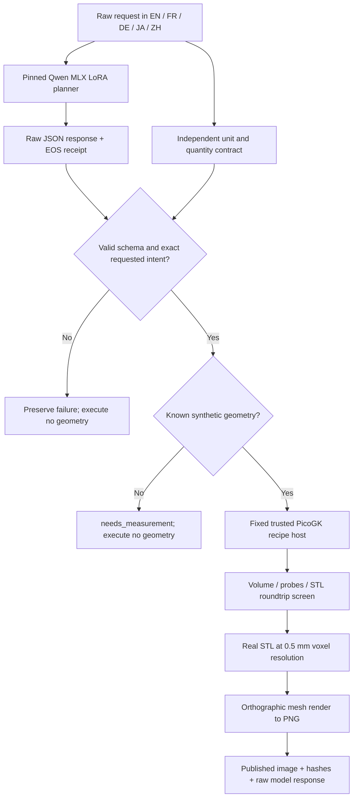
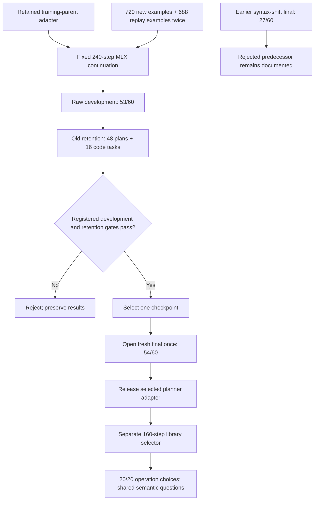

# Architecture and evidence flow

These diagrams describe the released research system. The model proposes
bounded parameter plans; the fixed PicoGK host constructs the geometry.
Every image in the [gallery](visuals/README.md) follows the first pipeline.

## From our LLM to a visible PicoGK mesh

The gallery uses the **raw** recorded requests and actually calls our selected
adapter again. It does not feed the expected plan into the model. The
independent contract checks the result after inference. By contrast, the
ordinary structured `infer.py` command canonicalises explicit fields before
inference and refuses unknown interfaces before calling the model.

Model output is never executable C#, package names, build commands or file
paths. The renderer shades the actual native STL triangles; no image model
creates or alters the shape. A render is separate from engineering validation.

## How the released checkpoint was selected

The final partitions are now public and exposed. Gallery examples are selected
successful exposed cases, not an additional generalisation test. The 27/60
and 54/60 finals have different prospective protocols; they must not be
presented as the same held-out benchmark. The selector has its own output
schema and cannot replace the geometry planner.
