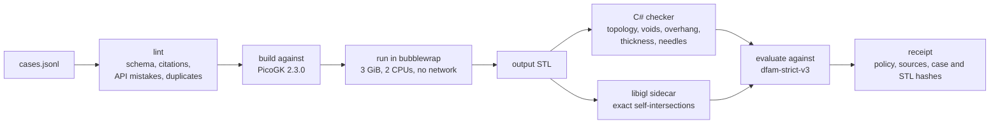
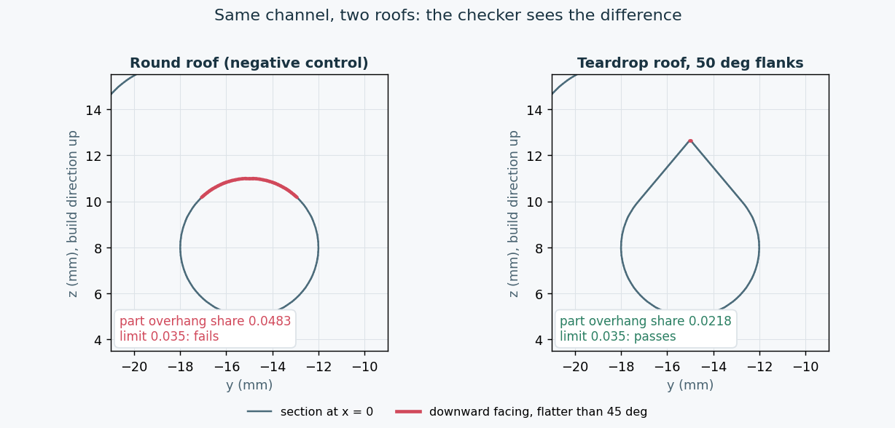
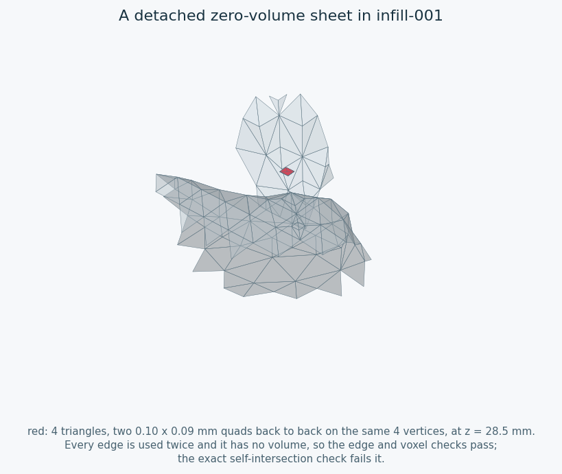
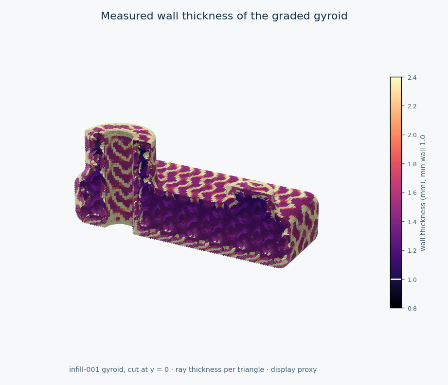

# PicoGK DfAM corpus: authoring, verification and training gates

This is a work-in-progress teaching corpus, separate from the released
parameter planner and the AM C# study. It has **four examples**, not 150
completed examples and not a newly trained model. Under the current
`dfam-strict-v3` policy, `scan-001`, `dfam-001` and `debug-001` pass isolated
native verification on Linux ([receipt](../evidence/dfam-code/strict-v3-20261015.json)).
The historical `infill-001` source and receipts remain unchanged; it is
blocked by 86 degenerate triangles, the same 86 as needle triangles, and a
detached zero-volume sheet that the self-intersection check reports. The
earlier [strict-v2 receipt](../evidence/dfam-code/strict-v2-20261015.json) is
kept as history. No training partitions are published. The wider plan for
physics evidence is in [PHYSICS_EVIDENCE_PLAN.md](PHYSICS_EVIDENCE_PLAN.md).



## Acceptance gates

1. `lint` checks field types, finite ordered thresholds, safe output filenames,
   registered citations, known API mistakes and near-duplicate prompts/code.
2. `verify` runs lint before compilation, restores locked NuGet dependencies,
   and runs candidate C# only in the isolated Linux process described below.
3. The separate checker measures the actual STL. Zero detected boundary edges,
   non-manifold edges, inconsistent orientation edges, degenerate triangles,
   needle triangles and self-intersecting triangle pairs are required,
   together with one raster-connected solid. All required metrics must be
   present, finite and in their valid domains.
4. Enclosed-void tolerances remain 2 mm³ total and 0.25 mm³ for the largest
   pocket. These account for raster artefacts at 0.3 mm and must not be
   described as proof that no powder remains. Declared volume, thin-feature
   and overhang limits are enforced. Infill/DfAM examples must declare wall,
   thin-feature, thin-wall-area and overhang assumptions before assembly; no
   universal machine-specific printability threshold is invented for them.
5. A new receipt binds the current verifier, checker sources, exact case
   content and output STL hashes. Assembly recomputes the verdict from the
   recorded metrics, rejecting legacy, modified, incomplete or stale evidence.
   Receipts are owner-controlled provenance records, not signed attestations.

### What strict-v3 adds

| Measurement | Method | Gate |
|---|---|---|
| Self-intersecting triangle pairs | libigl `find_self_intersections`: AABB tree with exact predicates, on vertices welded on the checker's 0.0001 mm grid; hash-pinned wheels in a separate environment | 0 required |
| Needle triangles | Distinct vertices, but height below 1e-3 of the longest edge | 0 required |
| Wall thickness | A ray from every triangle's centroid along the inward normal to the first other triangle, on the mesh itself, so a 1.0 mm wall is not quantised to 0.3 mm cells; capped at max(4 x min wall, 3 mm) | Area-weighted 1st and 5th percentiles reported; `thin_wall_area_fraction` (area below the minimum wall) gated when a case declares `thin_wall_area_fraction_max` |

Both new tools are trusted code. They read only the output STL, and the
receipt's `checker_source_sha256` binds the C# checker and the sidecar
sources. Each rebuild runs known-answer self-tests: plates of 0.6 and 2.0 mm,
a needle triangle, a closed cube, separate cubes and overlapping cubes.



The overhang screen separates the two channel designs.
[`dfam-001`](../data/dfam-code/cases.jsonl) passes with an overhang share of
0.0218; the same channel with a round roof is kept as a
[negative control](../evidence/dfam-code/negative-controls/) and fails the
declared 0.035 limit at 0.0483.



The self-intersection check found a defect the earlier checks could not
see. In `infill-001`, four triangles form two 0.10 x 0.09 mm quads back to
back on the same four vertices: a detached sheet with no volume. Every edge
is used exactly twice, so the edge checks pass. It has no volume, so the
voxel component count does not see it. The numerical vertex weld proposed
for this case in #6 removes the degenerate triangles, but not this sheet.



On the gyroid, the ray thickness gives a 1st percentile of 1.05 mm and a
5th percentile of 1.20 mm, with 0.37 % of the surface area below the
assumed 1.0 mm minimum. That matches the design, which grades the sheets
down to 1.0 mm at the top. The [turntable](visuals/dfam/infill-thickness-turntable.gif)
shows the whole cut part.

### Limits of the checks

The checker still does not establish strength, fatigue, dimensional
accuracy, printability or successful depowdering. A ray cast along a wall
overestimates its thickness, so a thin wall is detected from its broad faces;
percentiles and area shares are therefore more reliable than a single
minimum value. Values above the cap are reported as the cap. The
morphological thin-feature fraction remains a voxel screen. A bounded ray
grid can miss small features and cannot establish physical powder-flow
behaviour. Self-intersection freedom is established only for the exact
output STL, after welding on the 0.0001 mm grid.

## Native verification environment

Use a Linux workstation with .NET 9, the PicoGK 2.3.0 package and its matching
Linux native runtime, bubblewrap, `/usr/bin/prlimit`, and a working systemd
user manager with delegated memory and task controllers. Kernel policy must
permit bubblewrap's namespaces. macOS can lint, check receipts and prepare
tokenized data; it cannot run this isolated native verifier.

Candidate execution has:

- separate namespaces, including networking, and no inherited application
  environment;
- read-only system/.NET/PicoGK runtime and runner assemblies;
- only the selected input fixture, mounted read-only;
- one writable case output directory and a private temporary filesystem;
- a 3 GiB memory limit, no swap, 128 tasks, two declared .NET processors,
  a 300-second CPU limit, a 256 MiB per-file limit and a wall timeout;
- a two-CPU cgroup quota (`CPUQuota=200%`). The CPU limit counts every
  thread, including PicoGK's native OpenVDB threads, which ignore the .NET
  processor count and otherwise use all host cores.
- .NET write-xor-execute double mapping disabled
  (`DOTNET_EnableWriteXorExecute=0`). With it enabled, the runtime is killed
  by the per-file limit (SIGXFSZ, exit 153) before any case code runs.

The checker and fixture generator use 4 GiB scopes. Missing limit/isolation
facilities refuse the operation before native fixture generation. A failing
bubblewrap startup also fails the case. Candidate stdout/stderr go to a file;
the parent reads only a bounded tail instead of accumulating untrusted logs
in memory. Symlink outputs and escaping paths are refused.

The writable output directory has no aggregate disk quota. These controls
are defence in depth for reviewed teaching code; they are not a hardened
multi-tenant service. Do not use the verifier as an arbitrary public-code
execution API. Native isolation still needs an end-to-end check on the target
Linux host; portable CI exercises policy, schema and command construction.

```sh
export DOTNET_ROOT=/path/to/dotnet
export PATH="$DOTNET_ROOT:$PATH"
export PICOGK_NATIVE=/path/to/matching/picogk/native
python3.12 scripts/dfam_corpus.py lint data/dfam-code/cases.jsonl
python3.12 scripts/dfam_corpus.py verify data/dfam-code/cases.jsonl \
  --tag strict-v3-review --jobs 1 \
  --receipt work/dfam-strict-v3.json
```

The first `verify` builds the C# checker and runs its self-test. It also
creates `work/dfam-selfcheck/`, a Python virtual environment installed with
`pip --require-hashes --only-binary=:all:` from
`dfam-native/SelfCheck/requirements.txt` (libigl 2.6.3, numpy 2.2.6 and
scipy 1.15.3; Linux x86_64, CPython 3.12), and runs the sidecar's self-test.
Like NuGet, this preparation needs network access; candidate code never does.

The first case is expected to fail the strict geometry gate until its author
repairs the mesh and reruns verification. Do not alter the historical receipt
or loosen a threshold to admit it. Compiler/native dependency preparation can
access NuGet before candidate execution; candidate namespaces have no network.
Verification refuses existing run tags and receipt paths to preserve prior
evidence. Choose a new tag/path for a new run.

## Complete the corpus and reserve evaluation families

The planned allocation is:

| Category | Train | Validation | Test | Total |
|---|---:|---:|---:|---:|
| Scan repair | 36 | 5 | 4 | 45 |
| Bionic infill | 48 | 6 | 6 | 60 |
| DfAM | 24 | 3 | 3 | 30 |
| Troubleshooting | 12 | 1 | 2 | 15 |
| Total | 120 | 15 | 15 | 150 |

Register a stable `family` and a `split` in each case's authoring `meta.json`
before training. A family covers related geometry/algorithm variants, including
different dimensions, languages, noise levels and prompt wrappers. Every
variant stays in the same partition; the assembler rejects cross-partition
families and lexical near-duplicates. This grouping needs human review:
different labels alone do not prove independent families. Keep future test
authors and test results separate from training decisions. Existing public
examples and exposed tests cannot be called untouched holdouts.

Prioritize genuinely different data/operations: oriented versus unoriented
point clouds, open versus closed meshes, multiple components, thin features,
internal channels, independent lattice families and failure/refusal cases.
Do not generate 149 numeric paraphrases of the gyroid example. Each new
case needs provenance, scoped references, explicit assumptions and fresh
native verification. The current synthetic fixture is only one shape: add
independent fixture families and unseen native integration tests before
claiming generalization. A scalar `family` field alone does not supply those
new fixtures or qualify another part.

## Assemble without truncating C#

Use the pinned Python 3.12 requirements and a local base matching `release.json`.
Only the tokenizer is loaded; no weights are trained by this command.

```sh
python3.12 scripts/dfam_corpus.py assemble \
  --receipt work/dfam-strict-v3.json --base /path/to/exact/base
python3.12 scripts/dfam_corpus.py assemble --check \
  --receipt work/dfam-strict-v3.json --base /path/to/exact/base
```

Both commands currently refuse the incomplete one-case corpus with an explicit
diagnostic. They require the complete category counts and partition plan,
current passing native receipts and unchanged base files. The tokenizer applies
its actual chat template once, including end markers. Every row must fit
`max_seq_length=8192`; excess length is an error, not silent truncation.

The output uses `{"messages": [...]}`, compatible with MLX prompt masking.
Assembly preserves existing partition files: differing files are refused,
and unchanged files are left in place. Use a new corpus version for a new
partition protocol.
Raw `text` ChatML rows are incompatible with `mask_prompt: true` in the pinned
MLX-LM 0.31.3. The current example is about 3.6k tokens; the original 1,024-token
planner configurations are unsuitable for complete DfAM programs.

`training/configs/dfam-code.json` is a JSON configuration (also valid YAML),
with an 8,192-token context, batch size one and gradient checkpointing. It is
a starting configuration, not evidence of model quality or a measured memory
budget. Register the checkpoint, mixture, schedule and new evaluation protocol
before running a course. The released adapters and their results are unchanged.

```sh
python3.12 -m mlx_lm lora --model /path/to/exact/base \
  --train --data data/dfam-code --adapter-path work/dfam-candidate \
  --config training/configs/dfam-code.json
```

Run that only after the gates above pass. Do not select checkpoints using the
reserved test set. Report compilation rate, geometry pass rate, refusals and
retention against the same frozen baseline separately; successful corpus
validation does not prove that Qwen can independently generate those programs.
