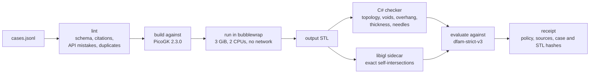
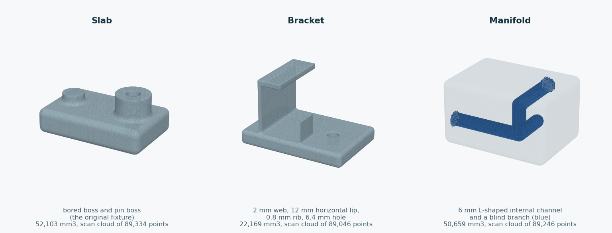
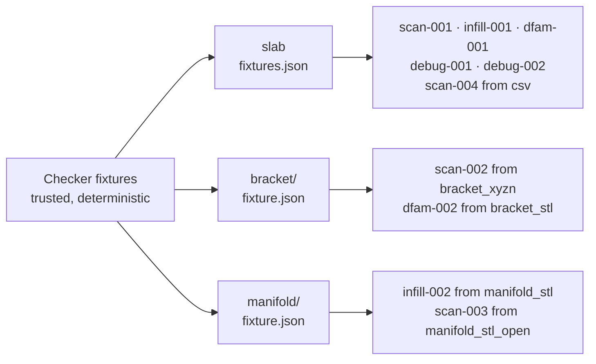
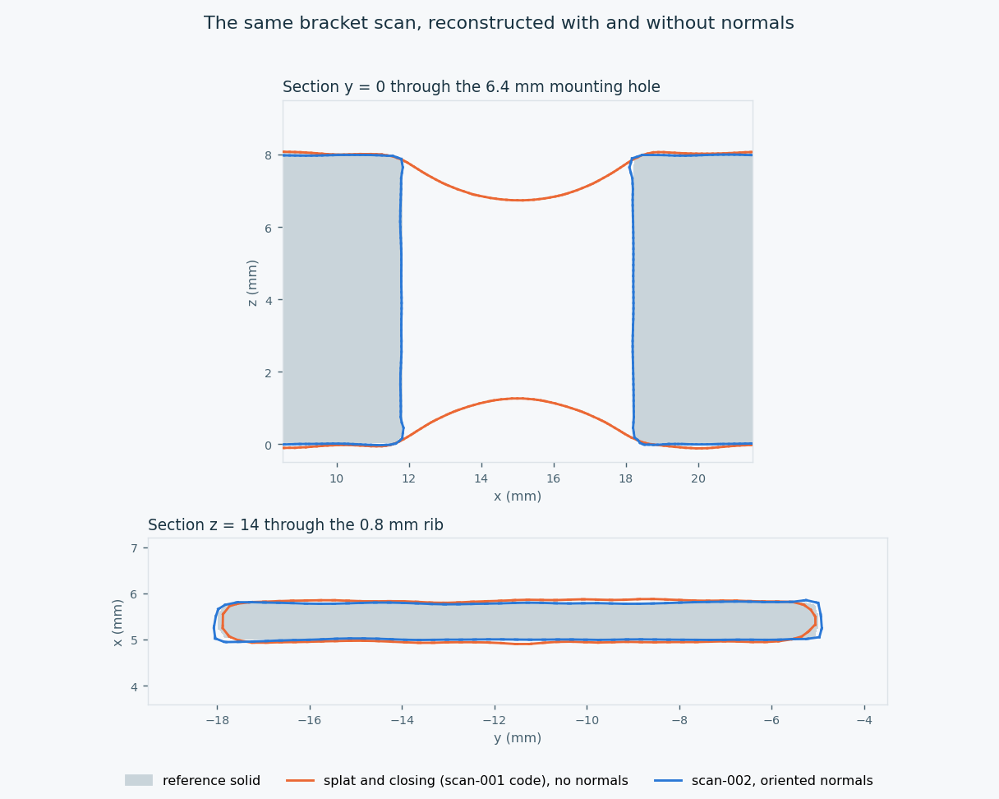
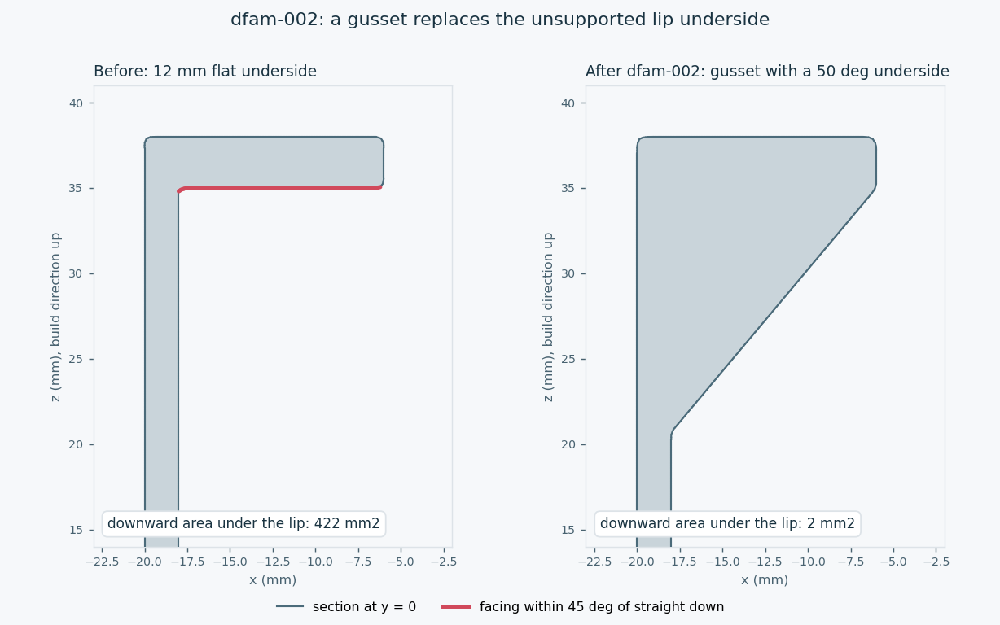
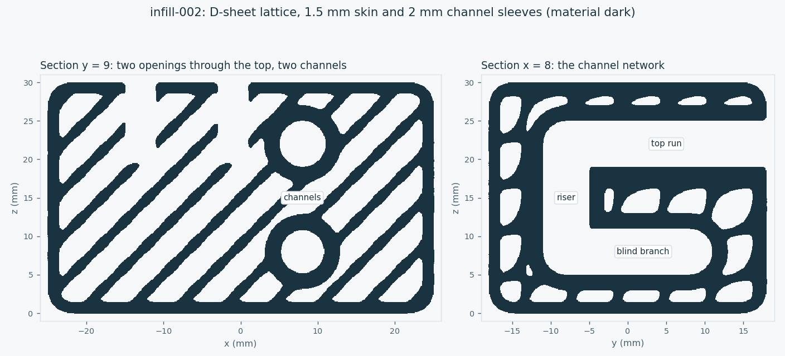
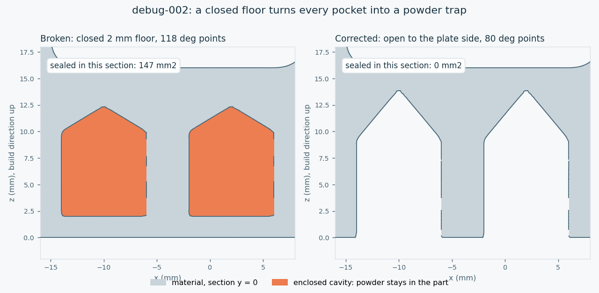

# PicoGK DfAM corpus: authoring, verification and training gates

This is a work-in-progress teaching corpus, separate from the released
parameter planner and the AM C# study. It has **ten examples**, not 150
completed examples and not a newly trained model. Under the current
`dfam-strict-v3` policy, all ten cases pass isolated native verification on
Linux ([receipt](../evidence/dfam-code/strict-v3-20261021.json)).
- `scan-003` and `scan-004` were added on 2026-10-21. They are the first
  cases to read the open STL and the CSV inputs.
- `scan-002`, `dfam-002`, `infill-002` and `debug-002` were added on
  2026-10-19, together with two new [fixture families](#fixture-families).
- `infill-001` was revised to weld its export, drop collapsed faces and
  remove the detached zero-volume sheet described below. Its original source
  is archived in `evidence/dfam-code/snapshots/`.
- The [2026-10-19](../evidence/dfam-code/strict-v3-20261019.json),
  [2026-10-17](../evidence/dfam-code/strict-v3-20261017.json) and
  [first](../evidence/dfam-code/strict-v3-20261015.json) strict-v3 receipts
  and the [strict-v2](../evidence/dfam-code/strict-v2-20261015.json) receipt
  are kept as history.

No training partitions are published. The wider plan for
physics evidence is in [PHYSICS_EVIDENCE_PLAN.md](PHYSICS_EVIDENCE_PLAN.md).



## Shared export cleanup

PicoGK's mesher can emit zero-area triangles where a surface passes exactly
through voxel lattice points. Six cases (`infill-001`, `debug-001`,
`dfam-001`, `dfam-002`, `infill-002` and `debug-002`) therefore embed the
same export cleanup, kept as a single source in
`dfam-native/MeshCleanup.cs`. It replaces vertices consistently by the first
vertex in each rounded 0.0001 mm cell, which is the checker's own weld
convention. A vertex whose own cell is still empty also joins a vertex within
0.0001 mm in a neighbouring cell. Without that, two vertices 0.1 µm apart on
either side of a cell boundary stay separate and form needle triangles; the
mesher leaves such pairs where a surface passes almost exactly through a
voxel node, and `infill-002` had two. The helper then drops faces that
collapse. Dropping tiny faces without welding their neighbours could open
real holes. It preserves winding, never moves a vertex further than the
cell diagonal, and reports the number of removed faces and the largest
vertex displacement. A test fails if a case that defines `MeshCleanup` does
not embed this exact source.

The pure C# `CleanupChecks` executable tests the helper on its own: a closed
tetrahedron with near-duplicate vertices, the same across a cell boundary, a
needle across a boundary, vertices just beyond the tolerance kept apart,
collapsed and collinear faces, untouched valid faces, idempotence, the
movement bound, and invalid, non-finite or overflowing input. It loads
neither PicoGK nor corpus code and runs as a separate CI job. It is a unit test of the weld, not native
verification of any part. The zero-volume shell removal in `infill-001` is
not part of this helper and is covered by the native receipt instead.

```sh
dotnet run --project dfam-native/CleanupChecks/CleanupChecks.csproj -c Release
```

## Fixture families

The trusted checker generates every input deterministically
(`Checker fixtures DIR VOXEL`). A family has a closed STL, an open STL with
three scanner gaps, and a noisy point cloud with about 0.5 % outliers, written
as `.xyz`, `.xyz` with normals and `.csv`. Since 2026-10-19 there are three
families. The original slab is reproduced byte for byte, so the older
receipts still describe their inputs.



| Family | Files | Shape | What it exercises |
|---|---|---|---|
| slab | `fixtures.json`, `part.stl`, ... | 70 x 44 x 30 mm slab with a bored boss and a pin boss | the original cases |
| bracket | `bracket/` | 60 x 40 x 38 mm: base plate, 2 mm web, 12 mm horizontal lip, 0.8 mm rib, 6.4 mm hole | overhangs, thin walls, small holes |
| manifold | `manifold/` | 50 x 36 x 30 mm block with a 6 mm L-shaped internal channel and a blind branch | internal channels, sealing, powder removal |

Input kinds are `xyz`, `xyzn`, `csv`, `stl` and `stl_open` for the slab, and
the same names prefixed with the family for the others, such as
`bracket_xyzn` or `manifold_stl`. Only the selected file is mounted in the
sandbox, and each output is compared with its own family's `fixture.json`, so
`volume_ratio_to_fixture` refers to the right part. The shapes are synthetic
and are not vehicle parts.



One radius had to change before the bracket was usable. A 3.0 mm hole
centred on a voxel node meets the 0.3 mm grid exactly, and the mesher emitted
200 zero-area triangles on its wall. The hole is now 3.2 mm in radius, a
6.4 mm M6 clearance hole.

## Acceptance gates

1. `lint` checks field types, finite ordered thresholds, safe output filenames,
   registered citations, known API mistakes and near-duplicate prompts/code.
2. `verify` runs lint before compilation, restores locked NuGet dependencies,
   and runs candidate C# only in the isolated Linux process described below.
3. The separate checker measures the actual STL. Zero detected boundary edges,
   non-manifold edges, inconsistent orientation edges, degenerate triangles,
   needle triangles and self-intersecting triangle pairs are required,
   together with one raster-connected solid. All required metrics must be
   present, finite and in their valid domains.
4. Enclosed-void tolerances remain 2 mm³ total and 0.25 mm³ for the largest
   pocket. These account for raster artefacts at 0.3 mm and must not be
   described as proof that no powder remains. Declared volume, thin-feature
   and overhang limits are enforced. Infill/DfAM examples must declare wall,
   thin-feature, thin-wall-area and overhang assumptions before assembly; no
   universal machine-specific printability threshold is invented for them.
5. A new receipt binds the current verifier, checker sources, exact case
   content and output STL hashes. Assembly recomputes the verdict from the
   recorded metrics, rejecting legacy, modified, incomplete or stale evidence.
   Receipts are owner-controlled provenance records, not signed attestations.

### What strict-v3 adds

| Measurement | Method | Gate |
|---|---|---|
| Self-intersecting triangle pairs | libigl `find_self_intersections`: AABB tree with exact predicates, on vertices welded on the checker's 0.0001 mm grid; hash-pinned wheels in a separate environment | 0 required |
| Needle triangles | Distinct vertices, but height below 1e-3 of the longest edge | 0 required |
| Wall thickness | A ray from every triangle's centroid along the inward normal to the first other triangle, on the mesh itself, so a 1.0 mm wall is not quantised to 0.3 mm cells; capped at max(4 x min wall, 3 mm) | Area-weighted 1st and 5th percentiles reported; `thin_wall_area_fraction` (area below the minimum wall) gated when a case declares `thin_wall_area_fraction_max` |

Both new tools are trusted code. They read only the output STL, and the
receipt's `checker_source_sha256` binds the C# checker and the sidecar
sources. Each rebuild runs known-answer self-tests: plates of 0.6 and 2.0 mm,
a needle triangle, a closed cube, separate cubes and overlapping cubes.


The overhang screen separates the two channel designs.
[`dfam-001`](../data/dfam-code/cases.jsonl) passes with an overhang share of
0.0218; the same channel with a round roof is kept as a
[negative control](../evidence/dfam-code/negative-controls/) and fails the
declared 0.035 limit at 0.0483.


The self-intersection check found a defect the earlier checks could not
see. In `infill-001`, four triangles form two 0.10 x 0.09 mm quads back to
back on the same four vertices: a detached sheet with no volume. Every edge
is used exactly twice, so the edge checks pass. It has no volume, so the
voxel component count does not see it. A vertex weld alone, as proposed in
#6, removes the degenerate triangles but not this sheet. The revised case also
drops edge-connected shells, other than the main body, that enclose less than
1e-6 mm³.


On the gyroid, the ray thickness gives a 1st percentile of 1.05 mm and a
5th percentile of 1.20 mm, with 0.37 % of the surface area below the
assumed 1.0 mm minimum. That matches the design, which grades the sheets
down to 1.0 mm at the top. The [turntable](visuals/dfam/infill-thickness-turntable.gif)
shows the whole cut part.

### Cases added on 2026-10-19

All numbers below are from the
[2026-10-19 receipt](../evidence/dfam-code/strict-v3-20261019.json).

**`scan-002`: oriented point cloud to solid.** The bracket's cloud with
normals is turned into a signed distance field. Tangent-plane distances
(Hoppe et al. 1992) give the magnitude. Where nearby faces disagree on the
side, at sharp corners and beside thin walls, the generalised winding number
of the oriented samples (Barill et al. 2018) decides. The volume is within
0.11 % of the reference, the 0.8 mm rib survives (1st-percentile wall
0.79 mm) and the 6.4 mm hole stays open. Run through `scan-001`'s published
code outside the verifier, the same points without normals cap the hole and
come out 6.7 % over volume. Both keep the rib; the closing rounds its ends.



Two pitfalls found while writing it are explained in the case:
- With random sampling, the rib's corner is sampled more coarsely than its
  edge radius, so the nearest sample's tangent plane can point the wrong way.
- A field value within a hair of zero at a voxel node makes the mesher stack
  vertices there and leave needle triangles. The field is kept at least
  0.003 mm from zero.

**`dfam-002`: gusset and rib.** A gusset whose underside rises at 50 deg
replaces the 12 mm flat underside of the lip, and the 0.8 mm rib is
thickened to 1.2 mm. The downward area under the lip falls from 422 to
2 mm², the part's overhang share is 0.0059 against a declared 0.01, the
1st-percentile wall is 1.2 mm and the volume grows by 14 %. The program
probes the stated layout first and refuses a part that does not match.



**`infill-002`: sleeved channels in a lattice block.** A morphological
closing finds the manifold's channels without a hard-coded path. Each
channel keeps a solid 2 mm sleeve, the rest becomes a D-sheet lattice, and
openings come in through the top, at least the minimum wall away from any
channel. About 300 mm³ of lattice pockets that skin and sleeves cut off from
every opening are made solid rather than left as powder traps. Volume ratio
0.570, overhang share 0.111 (declared 0.13), 0.19 % of the area below
1.0 mm and no enclosed void. The [section sweep](visuals/dfam/infill-002-section-sweep.gif)
moves the cut through the whole block.



**`debug-002`: sealed pockets.** A `runtime_failure` case: the broken program
compiles and runs, and the checker rejects its output for 2,623 mm³ of
enclosed voids in six pockets of 437 mm³, plus 388 degenerate triangles from
an unwelded export. The corrected program opens each pocket through the
bottom face, uses 80 deg points with flanks 50 deg from the plate instead of
118 deg drill points, checks every pocket's wall and checks itself for
sealed volume.



### Cases added on 2026-10-21

Both are scan repairs with methods the corpus did not have yet. All numbers
are from the [2026-10-21 receipt](../evidence/dfam-code/strict-v3-20261021.json),
which also re-verifies the eight earlier cases.

**`scan-003`: open STL repaired on the mesh.** The manifold's open STL lacks
the triangles of three 6 mm scanner gaps. The program welds the triangle
soup, finds the hole rims as directed edges without a reverse, and closes
each rim with a minimum-area triangulation computed by dynamic programming
(Barequet and Sharir 1995). It then voxelises and remeshes the closed
surface. Volume ratio 1.0001, no enclosed void, and the 6 mm channel and its
ports stay open, in 28 s. Run through `scan-001`'s published code outside the
verifier, the manifold's point cloud comes out 5.6 % over volume with no
enclosed void, about the channel's volume: the closing bridges the ports and
fills the channel. The program stops on flipped, duplicate or non-manifold
faces, and on holes wider than a scanner gap (12 mm bounding-box diagonal).

**`scan-004`: CSV cloud with normals estimated from the points.** The slab's
`scan.csv` is read by header name, so column order, units in the header,
semicolons and decimal commas do not matter, and normal columns are ignored.
Normals come from PCA of each point's 16 neighbours and are oriented along a
minimum spanning tree (Hoppe et al. 1992). The solid is the signed distance
to the nearest tangent plane. Volume ratio 0.9984 with the 9 mm bore open,
against 1.0494 for `scan-001`'s closing on the same slab, in 63 s.

Three pitfalls found while writing it are explained in the case:
- With one-way neighbour links, a stray point is nobody's neighbour and
  keeps an arbitrary sign. Its plane then claims its whole Voronoi cell, a
  cone of material that runs out to the render box. Links go both ways.
- Fitted together with its own neighbours, an outlier tilts its plane
  towards itself and passes the offset test. Planes are fitted without the
  point.
- The orientation cost 1 − |ni · nj| rates the two faces of a thin wall as a
  perfect match, so the sign jumps through the wall. Links between parallel
  planes more than 0.25 mm apart are dropped.

On the bracket's 0.8 mm rib the method still fails, because 16-point
neighbourhoods span both faces. The program checks its own mesh for open
edges and refuses that input rather than exporting it. `scan-002`, which uses
the scanner's normals and a winding number, is the case for such parts.

### Limits of the checks

The checker still does not establish strength, fatigue, dimensional
accuracy, printability or successful depowdering. A ray cast along a wall
overestimates its thickness, so a thin wall is detected from its broad faces;
percentiles and area shares are therefore more reliable than a single
minimum value. Values above the cap are reported as the cap. The
morphological thin-feature fraction remains a voxel screen. A bounded ray
grid can miss small features and cannot establish physical powder-flow
behaviour. Self-intersection freedom is established only for the exact
output STL, after welding on the 0.0001 mm grid.

## Native verification environment

Use a Linux workstation with .NET 9, the PicoGK 2.3.0 package and its matching
Linux native runtime, bubblewrap, `/usr/bin/prlimit`, and a working systemd
user manager with delegated memory and task controllers. Kernel policy must
permit bubblewrap's namespaces. macOS can lint, check receipts and prepare
tokenized data; it cannot run this isolated native verifier.

Candidate execution has:

- separate namespaces, including networking, and no inherited application
  environment;
- read-only system/.NET/PicoGK runtime and runner assemblies;
- only the selected input fixture, mounted read-only;
- one writable case output directory and a private temporary filesystem;
- a 3 GiB memory limit, no swap, 128 tasks, two declared .NET processors,
  a CPU-time limit of two CPUs times the wall timeout (600 s at the default
  300 s), a 256 MiB per-file limit and a wall timeout. A fixed 300 s CPU budget
  made verdicts depend on machine load, because native threads spin when
  cores are contended;
- a two-CPU cgroup quota (`CPUQuota=200%`). The CPU limit counts every
  thread, including PicoGK's native OpenVDB threads, which ignore the .NET
  processor count and otherwise use all host cores.
- .NET write-xor-execute double mapping disabled
  (`DOTNET_EnableWriteXorExecute=0`). With it enabled, the runtime is killed
  by the per-file limit (SIGXFSZ, exit 153) before any case code runs.

The checker and fixture generator use 4 GiB scopes. Missing limit/isolation
facilities refuse the operation before native fixture generation. A failing
bubblewrap startup also fails the case. Candidate stdout/stderr go to a file;
the parent reads only a bounded tail instead of accumulating untrusted logs
in memory. Symlink outputs and escaping paths are refused.

The writable output directory has no aggregate disk quota. These controls
are defence in depth for reviewed teaching code; they are not a hardened
multi-tenant service. Do not use the verifier as an arbitrary public-code
execution API. Native isolation still needs an end-to-end check on the target
Linux host; portable CI exercises policy, schema and command construction.

```sh
export DOTNET_ROOT=/path/to/dotnet
export PATH="$DOTNET_ROOT:$PATH"
export PICOGK_NATIVE=/path/to/matching/picogk/native
python3.12 scripts/dfam_corpus.py lint data/dfam-code/cases.jsonl
python3.12 scripts/dfam_corpus.py verify data/dfam-code/cases.jsonl \
  --tag strict-v3-review --jobs 1 \
  --receipt work/dfam-strict-v3.json
```

The first `verify` builds the C# checker and runs its self-test. It also
creates `work/dfam-selfcheck/`, a Python virtual environment installed with
`pip --require-hashes --only-binary=:all:` from
`dfam-native/SelfCheck/requirements.txt` (libigl 2.6.3, numpy 2.2.6 and
scipy 1.15.3; Linux x86_64, CPython 3.12), and runs the sidecar's self-test.
Like NuGet, this preparation needs network access; candidate code never does.

Do not alter a historical receipt or loosen a threshold to admit a case.
Compiler/native dependency preparation can
access NuGet before candidate execution; candidate namespaces have no network.
Verification refuses existing run tags and receipt paths to preserve prior
evidence. Choose a new tag/path for a new run.

## Complete the corpus and reserve evaluation families

The planned allocation is:

| Category | Train | Validation | Test | Total |
|---|---:|---:|---:|---:|
| Scan repair | 36 | 5 | 4 | 45 |
| Bionic infill | 48 | 6 | 6 | 60 |
| DfAM | 24 | 3 | 3 | 30 |
| Troubleshooting | 12 | 1 | 2 | 15 |
| Total | 120 | 15 | 15 | 150 |

Register a stable `family` and a `split` in each case's authoring `meta.json`
before training. A family covers related geometry/algorithm variants, including
different dimensions, languages, noise levels and prompt wrappers. Every
variant stays in the same partition; the assembler rejects cross-partition
families and lexical near-duplicates. This grouping needs human review:
different labels alone do not prove independent families. Keep future test
authors and test results separate from training decisions. Existing public
examples and exposed tests cannot be called untouched holdouts.

Prioritize genuinely different data/operations: oriented versus unoriented
point clouds, open versus closed meshes, multiple components, thin features,
internal channels, independent lattice families and failure/refusal cases.
Do not generate 149 numeric paraphrases of the gyroid example. Each new
case needs provenance, scoped references, explicit assumptions and fresh
native verification. The fixtures are now three synthetic shapes. That is
still not evidence of generalisation: add more independent fixture families
and unseen native integration tests before claiming it. A scalar `family`
field alone does not supply new fixtures or qualify another part.

## Assemble without truncating C#

Use the pinned Python 3.12 requirements and a local base matching `release.json`.
Only the tokenizer is loaded; no weights are trained by this command.

```sh
python3.12 scripts/dfam_corpus.py assemble \
  --receipt work/dfam-strict-v3.json --base /path/to/exact/base
python3.12 scripts/dfam_corpus.py assemble --check \
  --receipt work/dfam-strict-v3.json --base /path/to/exact/base
```

Both commands currently refuse the incomplete ten-case corpus with an explicit
diagnostic. They require the complete category counts and partition plan,
current passing native receipts and unchanged base files. The tokenizer applies
its actual chat template once, including end markers. Every row must fit
`max_seq_length=8192`; excess length is an error, not silent truncation.

The output uses `{"messages": [...]}`, compatible with MLX prompt masking.
Assembly preserves existing partition files: differing files are refused,
and unchanged files are left in place. Use a new corpus version for a new
partition protocol.
Raw `text` ChatML rows are incompatible with `mask_prompt: true` in the pinned
MLX-LM 0.31.3. With the pinned tokenizer the current examples assemble to
3.2k-7.5k tokens (`scan-004` is the longest); the original 1,024-token
planner configurations are unsuitable for complete DfAM programs.

`training/configs/dfam-code.json` is a JSON configuration (also valid YAML),
with an 8,192-token context, batch size one and gradient checkpointing. It is
a starting configuration, not evidence of model quality or a measured memory
budget. Register the checkpoint, mixture, schedule and new evaluation protocol
before running a course. The released adapters and their results are unchanged.

```sh
python3.12 -m mlx_lm lora --model /path/to/exact/base \
  --train --data data/dfam-code --adapter-path work/dfam-candidate \
  --config training/configs/dfam-code.json
```

Run that only after the gates above pass. Do not select checkpoints using the
reserved test set. Report compilation rate, geometry pass rate, refusals and
retention against the same frozen baseline separately; successful corpus
validation does not prove that Qwen can independently generate those programs.
