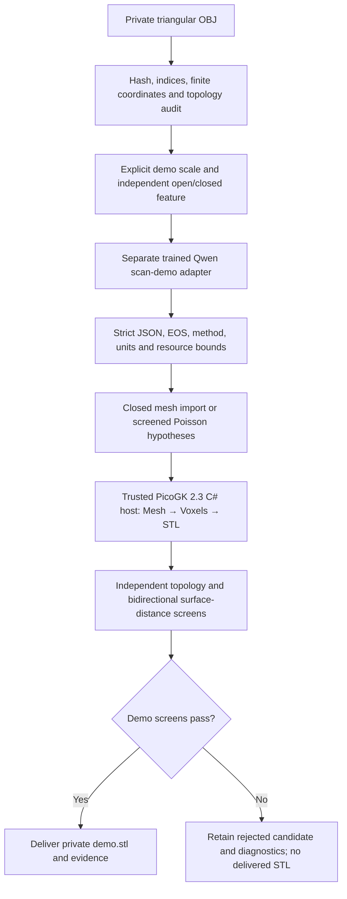

# End-to-end OBJ → Qwen proposal → PicoGK STL demo

The new task is an automated **tool-assisted reconstruction demo**. It does
not make the text adapter a 3D encoder or a metrology instrument. Qwen proposes
a bounded reconstruction strategy from independently extracted topology and
explicit assumptions. Established geometry algorithms process the actual
vertices and triangles, and PicoGK builds the voxel model and STL. A separate
audit controls delivery; Qwen cannot certify its own proposal or geometry.



## Scope and assumptions

The owner explicitly authorised hypotheses for a demonstration. The command
uses **1 mm per source coordinate unit**, **0.5 mm voxels**, **AlSi10Mg** as the
intended demonstration material and **laser powder bed fusion** as the intended
process. The material and process labels do not select machine parameters or
alter the mesh. A filename containing `0.5mm` does not calibrate the input.

The source is private and unchanged. Intake removes only exactly zero-area
triangles and applies a reversible rigid PCA pose. PCA is not a measured axis
or datum; no separate registration of a misaligned rear surface is performed.
Normals and material references in OBJ files are ignored, and referenced
material files are never opened. Polygons are rejected instead of silently
triangulated. Inputs are bounded to 256 MiB. No scan, reconstructed part or
user photograph is added to the public training corpus or repository.

For open input, the worker reduces the computational surface budget, estimates
normals and applies screened Poisson reconstruction. Missing surfaces become
**algorithmic hypotheses**, rather than measured geometry. Only tiny generated
components below the declared dust threshold are discarded. Independent scan
coverage must still pass. For closed input, the worker uses the acquired
surface directly. PicoGK then voxelises the closed surface and exports a new
mesh. This yields a voxel model, not a recovered feature-based CAD
design or inferred blade manufacturing drawing.

## What Qwen does

The original release remains unchanged. Its first scan-plan probe selected
direct voxelisation for an open scan and changed the requested 0.5 mm step to
5 mm. That answer was rejected. A separate 120-step continuation corrected
the step but still selected the wrong method for the specimen. It reached
23/24 development and 28/30 exact-preset final cases; those outcomes and the
failed specimen proposal remain evidence of a rejected candidate.

The separate 160-step course supplies a typed **open/closed** feature that is
derived from boundary-edge counts, rather than asking the language model to
infer topology from a large integer. Its 480 synthetic training records,
24 development records and 40 final records have disjoint numeric signatures;
the preceding final signatures are excluded. It continues from the released
planner with the same rank-8, scale-20, 16-layer LoRA, learning rate 1e-5, batch
two and prompt masking. No raw scan or scanned shape was used to train it.

The second candidate reaches **18/24 development and 31/40 exact-preset final**.
All 15 mismatches concern the specified 180,000-versus-300,000 face budget;
method, scale, voxel step and qualification flag agree in every recorded case.
These exact-preset scores are preserved. Execution separately permits either
of those two bounded budgets: retaining 300,000 faces is a valid, more expensive
geometry operation, even when the synthetic preset asked for 180,000. The
geometry screens remain mandatory. A separately registered fresh execution
final evaluates that policy; it must not be confused with the exact-preset
score or scan-reconstruction accuracy.

The fresh bounded-budget execution final passes **32/32** proposals. This is
tool-plan admission with typed metadata, not 32 successful scan reconstructions.

## Actual owner-selected fan OBJ: automatic run rejected

The selected input is the previously studied horizontal fan scan, identified
by its SHA-256. It has 624,492 vertices, 1,240,465 triangles and two acquired
surface components. Removing 26 exactly zero-area faces leaves 8,657 boundary
edges. The original bytes remain unchanged.

The single command calls the separate Qwen adapter, preserves its actual
Poisson/300,000-face/1 mm-per-unit/0.5 mm proposal without repair, reconstructs
the input, executes native PicoGK and performs the independent audit. It
produces 2,315,628 native triangles, passes closure, winding, positive volume,
zero-area and detected self-intersection/nonmanifold screens. Scan → native
P95 is 0.0722 assumed mm, with sampled maximum 0.2593 mm.

**It is rejected for delivery:** the STL has two substantial disconnected
components, rather than a tiny numerical speck, and native → open scan reaches
19.8988 assumed mm versus the registered 15 mm maximum. P95 in that direction
is 0.7051 mm; a low percentile does not excuse the unsupported closure. The
command exits 2 and creates no `demo.stl`. Its private candidate is retained
for diagnosis, and the public [rejection receipt](../evidence/scan-demo/automatic-scan-rejected.json)
contains metrics and provenance without mesh bytes.

This is evidence that the automatic chain and refusal work. It does not meet
the owner's target of an impeccable printable reconstruction. Rear registration,
unsupported hub/rear closures and complete component reconstruction remain
geometry work. Any alternative reconstruction is a new, separately screened
candidate; thresholds and the failed result are not silently changed.

The model emits JSON, not unrestricted executable C#. Its raw output is stored
without repair and must reach EOS. Unsupported methods, changed scale/voxel
step, additional fields, duplicate keys, invalid integer settings and any
claim of manufacturing qualification are rejected. The C# host is owned,
compiled source using the pinned real API. There is no shell command or file
path generated by Qwen, and no model-written program is executed.

## Geometry acceptance before delivery

The final STL must have a single component, closed edge topology, consistent
winding, positive volume, no zero-area faces, no detected self-intersecting
faces and no detected nonmanifold edges or vertices. Native positive volume
and equal STL roundtrip triangle count are recorded separately.

Two independent sets of 2,000 area-uniform samples measure distances to target
triangles, with fixed distinct seeds. Under the assumed scale, scan → native
must have P95 ≤ 1.5 mm and sampled maximum ≤ 10 mm. Native → open scan must have
P95 ≤ 3 mm and sampled maximum ≤ 15 mm. These broad demonstration thresholds
are registered before geometry evaluation. They are not fitment tolerances.
The reverse direction includes reconstructed closures where the scan has gaps.
Sampled maxima are not exact Hausdorff distances, and the filters are finite
numerical screens rather than mathematical proofs.

## Local command and runtime

The separate adapter is available in the experimental
[scan-demo-v0.1.0 release](https://github.com/cluster2600/qwen-picogk/releases/tag/scan-demo-v0.1.0).
Install the original planner/base as described in the main README, then add
the separate scan adapter:

```sh
gh release download scan-demo-v0.1.0 --repo cluster2600/qwen-picogk \
  --pattern scan-demo-mlx.zip
unzip scan-demo-mlx.zip
python3 scripts/check_release.py --weights
```

The chain currently targets the configured Apple-silicon Mac. Use the original
pinned inference environment and base, and the separate scan-demo adapter.
Docker must contain the registered local scientific image identified in
`scan-demo.json`; the command does not pull an image or install software.
That environment already supplies NumPy, SciPy, trimesh, rtree and PyMeshLab.
Its amd64 geometry tools run locally under Docker emulation. Native PicoGK runs
on macOS through .NET 9 and the locked official PicoGK 2.3.0 NuGet package.

```sh
.venv/bin/python scan_demo.py \
  --obj /private/path/fan.obj \
  --output work/new-fan-demo \
  --base /path/to/the/exact/pinned/base \
  --demo
```

The output directory must be new. Within a Git checkout, output is restricted
to ignored `work/`. Source/adapter hashes and runtime versions are checked;
Docker uses read-only source mounts and no network. Evidence includes intake,
actual raw Qwen response, reconstruction hypotheses, native metrics, independent
quality results, logs and a final result record. `demo.stl` appears only after
acceptance. Rejected intermediate files remain private for diagnosis.

## About the suggested screenshot code

The screenshots describe point spheres followed by dilation/erosion, and their
loader generates a synthetic sphere rather than reading the owner's OBJ.
That is a conceptual illustration, not an implemented fan reconstruction.
The installed/reflected PicoGK 2.3 API has `Library`, `Mesh`, `Lattice` and
`Voxels`; it has no `VoxelMatrix`, `PolyMesh` or `Library.Init` from those
screenshots. The actual host uses `new Library(voxel)`,
`Mesh.mshFromStlFile`, `new Voxels(mesh)`, `mshAsMesh` and `SaveToStlFile`.
See the [official PicoGK source](https://github.com/leap71/PicoGK).

Adding spheres and closing gaps can alter bores, merge adjacent blades and
change wall thickness. Neither that recipe nor Poisson reconstruction proves
the missing material's shape. Our code retains the acquired scan and measures
the proposed result instead of calling arbitrary smoothing a reconstruction.

## Remaining metal-print work

A successful result is a **geometry-screened demonstration STL**. A supplier
still needs machine-specific orientation, support access/removal, powder
evacuation, minimum features, allowances, calibrated parameters, thermal
distortion control, heat treatment, machining and inspection. The workflow
does not produce those settings, a machine build file or a physical print.

For a working rotor, measured interfaces, rear registration, material/process
allowables, load cases, fatigue/overspeed assessment and balancing are separate
requirements. Demonstration assumptions do not authorise installation or
rotation. Genuine feature-based reconstruction would require segmented blade
profiles, hub/bore axes and independently measured interfaces, followed by
feature-to-PicoGK program training and held-out geometry families. End-to-end
raw-scan learning would additionally require a dedicated 3D encoder and suitable
licensed scan/program training pairs.
