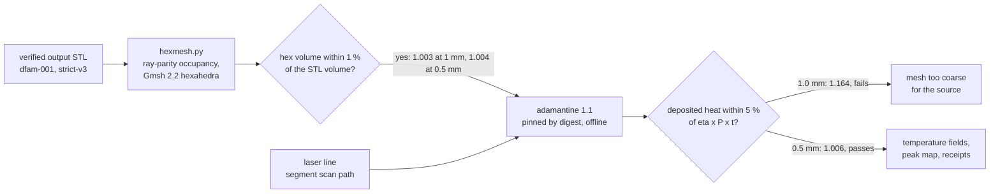
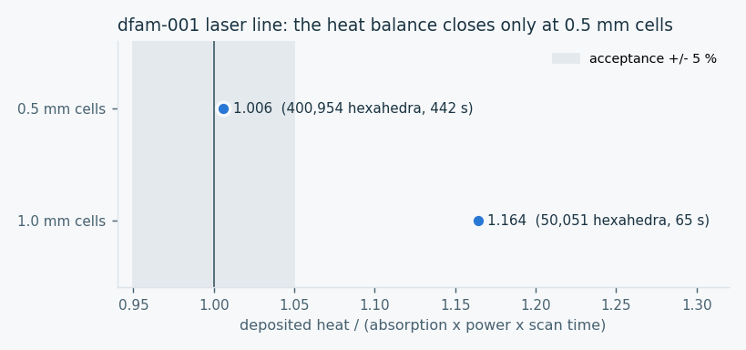
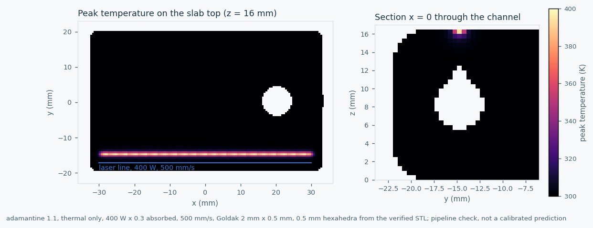
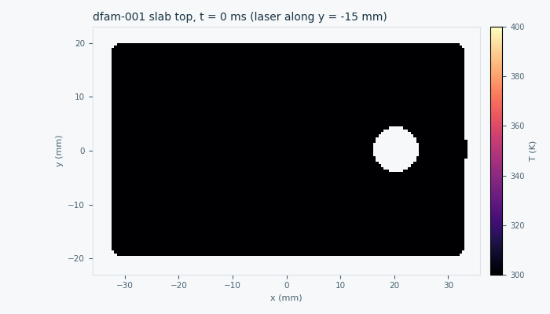
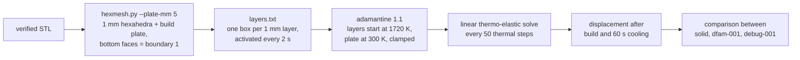

# Part-scale simulation with adamantine (Phase 3)

Phase 3 of the [physics evidence plan](PHYSICS_EVIDENCE_PLAN.md) connects the
verified corpus geometry to [adamantine](https://github.com/adamantine-sim/adamantine),
the part-scale thermo-mechanical code reviewed in the plan. This page records
the first step: a pinned image, a check against the image's own regression
data, and the chain from a verified STL to a thermal run on that geometry.

**Status, 16 October 2026:**
- The image is pinned, and the shipped example matches its regression data.
- A verified corpus STL now runs end to end in adamantine.
- The heat balance closes to 0.6 % at 0.5 mm cells.
- A lumped-layer thermo-elastic build mode exists and passed a three-layer
  trial (clamped plate held at zero displacement, layers activated on
  schedule).
- Builds of three variants (solid, `dfam-001`, `debug-001`) are running.
  Their comparison will be added when they finish.
- Three adamantine defects were found and reported upstream (see below).

Nothing here is calibrated or a prediction for a real machine.



## Image and regression check

`physics/adamantine/run_case.py` runs `rombur/adamantine:1.1` pinned by digest
(`sha256:ac735f9b…`, built 18 May 2026). Each run has no network, a read-only
root, all capabilities dropped, 12 GB of memory and a process limit, and runs as
the invoking user. The image is used as published; it is not rebuilt.

The `smoke` mode runs the image's own `demo_316_short` example, a 316L
deposition case with a Goldak source. It writes output at every step, so the
final state at t = 4 ms is saved. The upstream test `integration_3D_short`
checks that every temperature lies between 285 and 580 K, and on one or two
ranks checks each degree of freedom against `integration_3d_gold_short.txt`
within 10 %. Output files hold vertex values in a different order from the
solver's degrees of freedom, so only range statistics can be compared. Cells
above the material height are written with T = 0 and are excluded.

| | min (K) | max (K) | mean (K) |
|---|---:|---:|---:|
| Gold vector, 229,570 degrees of freedom | 300.00 | 474.40 | 301.470 |
| Final output, 60,408 active vertices | 300.00 | 473.82 | 301.478 |

All three checks pass, so the image runs as its own tests expect. The first
parse of the output counted the empty cells; that harness bug was fixed and the
run repeated. The receipt is
[adamantine-smoke-demo-316-short.json](../evidence/process/adamantine-smoke-demo-316-short.json).

## From a verified STL to adamantine

`physics/adamantine/hexmesh.py` turns a closed binary STL into a Gmsh 2.2
hexahedral mesh. A cell is solid when its centre is inside the mesh by vertical
ray parity, the same rule as the DfAM checker's occupancy raster.

The plan proposed an `export-hex` mode inside the checker. It is a separate
tool instead, because changing the trusted checker would change its source hash
and invalidate the corpus's strict-v3 receipts.

For `dfam-001`, the hex volume is within 1 % of the STL volume at both cell
sizes, which meets the plan's acceptance criterion:

| Cell size | Hexahedra | Hex volume / STL volume |
|---|---:|---:|
| 1.0 mm | 50,051 | 1.003 |
| 0.5 mm | 400,954 | 1.004 |

The `pipeline` mode imports that mesh with millimetre units and makes every
cell solid. It then runs a thermal-only simulation with one laser line on the
slab top, 3 mm to the side of the teardrop channel's axis:
- 400 W with 0.3 absorbed;
- 500 mm/s along y = -15 mm;
- a Goldak source 2 mm wide and 0.5 mm deep.

adamantine's `print_heat_input` logs the power it actually deposits at each
step. Its integral must match the absorbed energy, 0.3 x 400 W x 0.12 s =
14.4 J, within 5 %.



At 1 mm cells the solver deposits 16 % too much heat, because the 0.5 mm-deep
source is under-resolved. At 0.5 mm the balance closes to 0.6 %. That makes
0.5 mm the minimum cell size for this source, at about 7.5 minutes per run on
4 CPUs instead of 1 minute. The receipts keep both results:
[1.0 mm](../evidence/process/adamantine-pipeline-dfam-001-1.0mm.json),
[0.5 mm](../evidence/process/adamantine-pipeline-dfam-001-0.5mm.json).





The peak temperature is only about 395 K. At part scale a cell holds far more
heat capacity than the line delivers, so a moving beam warms the bulk but
cannot form a melt pool. That is why part-scale studies deposit lumped layers
at an elevated temperature rather than trace each beam path. The figures show
that the chain works and that the channel geometry survives meshing; they do
not predict temperatures on a machine.

## Upstream issues found while building this

Reading the adamantine 1.1 source in the pinned image (`a2e3a41`) confirmed
three defects. All three are still present on upstream `master` (`5aca53e`,
29 September 2026), and none had been reported when checked:

| Where | Defect | Effect on this work |
|---|---|---|
| `PostProcessor.cc`, `get_von_mises_stress` ([#501](https://github.com/adamantine-sim/adamantine/issues/501)) | The shear sum uses `tensor[2][1]`, which equals σyz for a symmetric tensor, so σyz is counted twice and σxz never enters | The von Mises output is not used; comparisons use displacement |
| `Microstructure.hh:144` ([#502](https://github.com/adamantine-sim/adamantine/issues/502)) | `_old_temperature[dof] - temperature[dof] / delta_t` lacks parentheses, giving T_old − T/Δt | Cooling-rate and G/R outputs are not used |
| `validate_input_database.cc:186` ([#503](https://github.com/adamantine-sim/adamantine/issues/503)) | `database.count("geometry.material_deposition_file")` passes a path to `ptree::count`, which matches only direct children, so file-based deposition is always rejected | Worked around with a root key of that literal name; documented in `run_case.py` |

All three were reported upstream on 16 October 2026.

## Lumped-layer build (thermo-elastic)



The `layers` mode of `run_case.py`:
- adds a 5 mm build plate under the part, clamped at its bottom faces;
- activates each 1 mm layer of the part at 1720 K, just above the liquidus,
  every 2 s;
- solves linear thermo-elastic mechanics every 50 thermal steps of 0.02 s;
- lets the part cool for 60 s after the last layer.

adamantine uses the solidus as the stress-free temperature of material that
has melted and the initial 300 K for the untouched plate. The layer boxes are
1 % shorter than a cell at each face; a three-layer trial showed that boxes
touching the next cell layer activate it early.

This is a flash-heating comparison model. Its layer time, convection and
emissivity are uncalibrated, and plasticity, build-plate removal and support
structures are not modelled. Results are differences between geometries under
one model, not distortion predictions.

## Next steps for Phase 3

1. **Lumped-layer deposition** of about 1 mm per layer, using adamantine's
   `material_deposition_method file` with a box file, which the plan's layer
   writer will produce. Each layer starts hot, as in an inherent-heat
   approach.
2. **Mechanical runs.** Before relying on the stress output, confirm the two
   suspected issues noted in the plan: the von Mises formula and the
   cooling-rate parentheses.
3. **Comparisons between variants:** solid, vented and lattice versions of
   `dfam-001` and `infill-001` on the same 0.5 mm mesh, reported as
   differences between variants. Lattices need a homogenised material, because
   1 mm walls cannot be resolved at this cell size.

## Reproduce

```sh
docker pull rombur/adamantine:1.1@sha256:ac735f9b6fec7626e79e91061cbd03b6274478fbafcaf2dcbe078c042affc9fa
python3 physics/adamantine/run_case.py smoke --out work/adamantine/smoke-NEW \
  --receipt work/adamantine/smoke-NEW.json
python3 physics/adamantine/run_case.py pipeline work/dfam-runs/TAG/dfam-001/part.stl \
  --cell-mm 0.5 --out work/adamantine/pipe-NEW --receipt work/adamantine/pipe-NEW.json
python3 physics/adamantine/render_figures.py --coarse ... --fine ... \
  --case work/adamantine/pipe-NEW --out docs/visuals/NEW-DIR
```

`hexmesh.py` and the figure script need numpy; `run_case.py smoke` needs only
the standard library.
