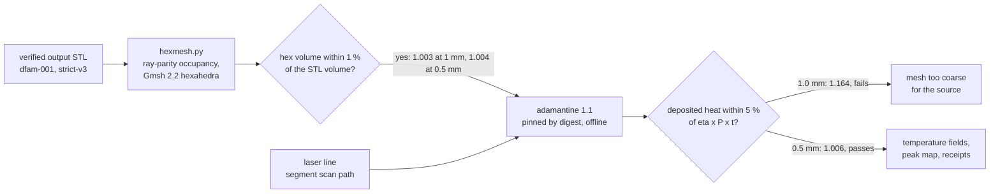
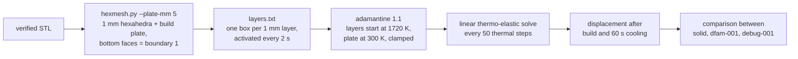
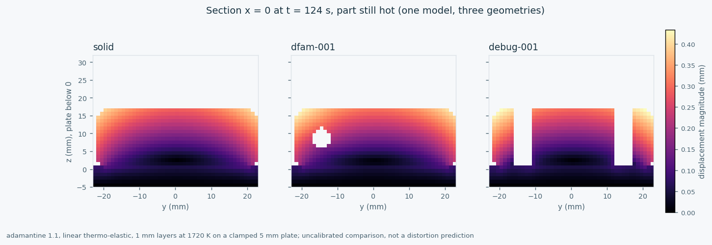
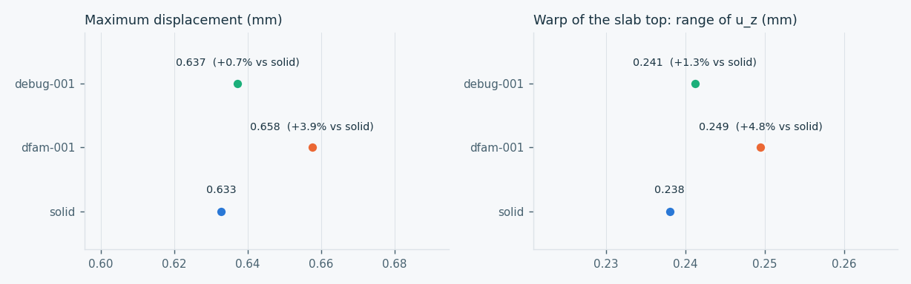
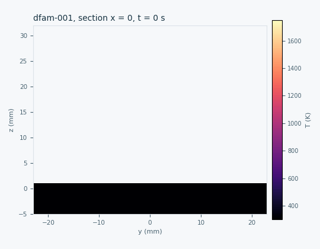
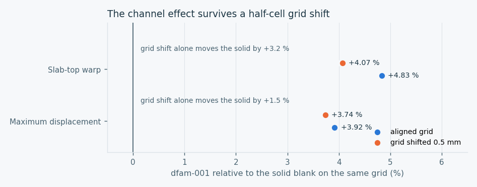
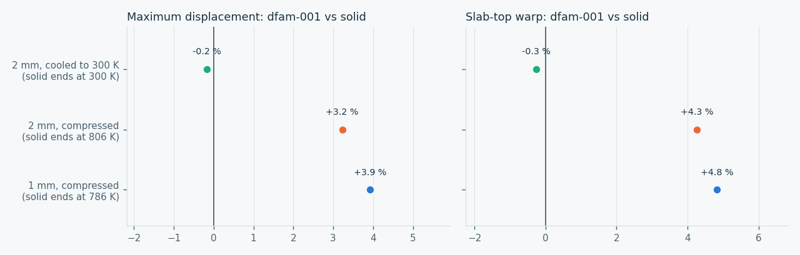

# Part-scale simulation with adamantine (Phase 3)

Phase 3 of the [physics evidence plan](PHYSICS_EVIDENCE_PLAN.md) connects the
verified corpus geometry to [adamantine](https://github.com/adamantine-sim/adamantine),
the part-scale thermo-mechanical code reviewed in the plan. This page records
the first step: a pinned image, a check against the image's own regression
data, and the chain from a verified STL to a thermal run on that geometry.

**Status, 16 October 2026:**
- The image is pinned, and the shipped example matches its regression data.
- A verified corpus STL now runs end to end in adamantine.
- The heat balance closes to 0.6 % at 0.5 mm cells.
- A lumped-layer thermo-elastic build mode exists and passed a three-layer
  trial (clamped plate held at zero displacement, layers activated on
  schedule).
- Builds of three variants (solid, `dfam-001`, `debug-001`) are complete.
  The channel raises displacement by 4 to 5 % while the part is hot. The
  effect survives a grid shift and a coarser mesh, but disappears once the
  part has cooled to 300 K, as linear thermo-elasticity requires (see below).
- Three adamantine defects were found and reported upstream (see below).

Nothing here is calibrated or a prediction for a real machine.



## Image and regression check

`physics/adamantine/run_case.py` runs `rombur/adamantine:1.1` pinned by digest
(`sha256:ac735f9b…`, built 18 May 2026). Each run has no network, a read-only
root, all capabilities dropped, 12 GB of memory and a process limit, and runs as
the invoking user. The image is used as published; it is not rebuilt.

The `smoke` mode runs the image's own `demo_316_short` example, a 316L
deposition case with a Goldak source. It writes output at every step, so the
final state at t = 4 ms is saved. The upstream test `integration_3D_short`
checks that every temperature lies between 285 and 580 K, and on one or two
ranks checks each degree of freedom against `integration_3d_gold_short.txt`
within 10 %. Output files hold vertex values in a different order from the
solver's degrees of freedom, so only range statistics can be compared. Cells
above the material height are written with T = 0 and are excluded.

| | min (K) | max (K) | mean (K) |
|---|---:|---:|---:|
| Gold vector, 229,570 degrees of freedom | 300.00 | 474.40 | 301.470 |
| Final output, 60,408 active vertices | 300.00 | 473.82 | 301.478 |

All three checks pass, so the image runs as its own tests expect. The first
parse of the output counted the empty cells; that harness bug was fixed and the
run repeated. The receipt is
[adamantine-smoke-demo-316-short.json](../evidence/process/adamantine-smoke-demo-316-short.json).

## From a verified STL to adamantine

`physics/adamantine/hexmesh.py` turns a closed binary STL into a Gmsh 2.2
hexahedral mesh. A cell is solid when its centre is inside the mesh by vertical
ray parity, the same rule as the DfAM checker's occupancy raster.

The plan proposed an `export-hex` mode inside the checker. It is a separate
tool instead, because changing the trusted checker would change its source hash
and invalidate the corpus's strict-v3 receipts.

For `dfam-001`, the hex volume is within 1 % of the STL volume at both cell
sizes, which meets the plan's acceptance criterion:

| Cell size | Hexahedra | Hex volume / STL volume |
|---|---:|---:|
| 1.0 mm | 50,051 | 1.003 |
| 0.5 mm | 400,954 | 1.004 |

The `pipeline` mode imports that mesh with millimetre units and makes every
cell solid. It then runs a thermal-only simulation with one laser line on the
slab top, 3 mm to the side of the teardrop channel's axis:
- 400 W with 0.3 absorbed;
- 500 mm/s along y = -15 mm;
- a Goldak source 2 mm wide and 0.5 mm deep.

adamantine's `print_heat_input` logs the power it actually deposits at each
step. Its integral must match the absorbed energy, 0.3 x 400 W x 0.12 s =
14.4 J, within 5 %.


At 1 mm cells the solver deposits 16 % too much heat, because the 0.5 mm-deep
source is under-resolved. At 0.5 mm the balance closes to 0.6 %. That makes
0.5 mm the minimum cell size for this source, at about 7.5 minutes per run on
4 CPUs instead of 1 minute. The receipts keep both results:
[1.0 mm](../evidence/process/adamantine-pipeline-dfam-001-1.0mm.json),
[0.5 mm](../evidence/process/adamantine-pipeline-dfam-001-0.5mm.json).


The peak temperature is only about 395 K. At part scale a cell holds far more
heat capacity than the line delivers, so a moving beam warms the bulk but
cannot form a melt pool. That is why part-scale studies deposit lumped layers
at an elevated temperature rather than trace each beam path. The figures show
that the chain works and that the channel geometry survives meshing; they do
not predict temperatures on a machine.

## Upstream issues found while building this

Reading the adamantine 1.1 source in the pinned image (`a2e3a41`) confirmed
three defects. All three are still present on upstream `master` (`5aca53e`,
29 September 2026), and none had been reported when checked:

| Where | Defect | Effect on this work |
|---|---|---|
| `PostProcessor.cc`, `get_von_mises_stress` ([#501](https://github.com/adamantine-sim/adamantine/issues/501)) | The shear sum uses `tensor[2][1]`, which equals σyz for a symmetric tensor, so σyz is counted twice and σxz never enters | The von Mises output is not used; comparisons use displacement |
| `Microstructure.hh:144` ([#502](https://github.com/adamantine-sim/adamantine/issues/502)) | `_old_temperature[dof] - temperature[dof] / delta_t` lacks parentheses, giving T_old − T/Δt | Cooling-rate and G/R outputs are not used |
| `validate_input_database.cc:186` ([#503](https://github.com/adamantine-sim/adamantine/issues/503)) | `database.count("geometry.material_deposition_file")` passes a path to `ptree::count`, which matches only direct children, so file-based deposition is always rejected | Worked around with a root key of that literal name; documented in `run_case.py` |

All three were reported upstream on 16 October 2026.

## Lumped-layer build (thermo-elastic)



The `layers` mode of `run_case.py`:
- adds a 5 mm build plate under the part, clamped at its bottom faces;
- activates each 1 mm layer of the part at 1720 K, just above the liquidus,
  every 2 s;
- solves linear thermo-elastic mechanics every 50 thermal steps of 0.02 s;
- lets the part cool for 60 s after the last layer.

adamantine uses the solidus as the stress-free temperature of material that
has melted and the initial 300 K for the untouched plate. The layer boxes are
1 % shorter than a cell at each face; a three-layer trial showed that boxes
touching the next cell layer activate it early.

This is a flash-heating comparison model. Its layer time, convection and
emissivity are uncalibrated, and plasticity, build-plate removal and support
structures are not modelled. Results are differences between geometries under
one model, not distortion predictions.

### Results: three geometries under one model

Each variant was built as 30 lumped layers of 1 mm, deposited every 2 s from
t = 2 s to t = 60 s. The schedule's two extra boxes above z = 30 mm contain no
cells. Cooling continued until t = 124 s, and the table compares that state.
The full record is
in [adamantine-layers-comparison.json](../evidence/process/adamantine-layers-comparison.json),
with one run receipt per variant (`adamantine-layers-run-*.json`). Their
`solver_seconds` include about 1.5 h when the host machine was suspended; the
three runs shared the machine's CPUs.

| Variant | Max displacement (mm) | Slab-top warp, range of u_z (mm) | Mean T at 124 s | Plate clamped |
|---|---:|---:|---:|---|
| `solid` | 0.633 | 0.238 | 786 K | yes |
| `dfam-001` | 0.658 (+3.9 %) | 0.249 (+4.8 %) | 751 K | yes |
| `debug-001` | 0.637 (+0.7 %) | 0.241 (+1.3 %) | 770 K | yes |







The largest displacement is at the top corner of the bored boss in all three
variants. Compared with the solid blank:
- `dfam-001`'s teardrop channel raises the maximum displacement by about 4 %
  and the slab-top warp by about 5 %;
- `debug-001`'s two clearance holes change both by about 1 %.

### Does the channel effect survive a different staircase?

A 0.5 mm repeat would cost about 32 times more. Explicit time stepping forces
a step four times smaller as well as eight times as many cells. So the solid
blank and `dfam-001` were rebuilt instead on the same 1 mm grid shifted by
half a cell in x and y. That staircases the channel differently: 49,577
instead of 50,051 cells, both within 1 % of the STL volume.



| `dfam-001` relative to the solid | Aligned grid | Shifted grid | Grid shift alone, solid |
|---|---:|---:|---:|
| Maximum displacement | +3.92 % | +3.74 % | +1.5 % |
| Slab-top warp | +4.83 % | +4.07 % | +3.2 % |

The grid shift moves the solid's absolute values by 1.5 to 3.2 %. The paired
channel effect moves much less: by 0.2 points for maximum displacement and
0.8 points for warp, keeping its sign. Within this model, the channel's 4 to
5 % increase is therefore robust to staircasing. The holes' smaller 1 % effect
was not retested and remains below the absolute grid sensitivity. Records:
[robustness](../evidence/process/adamantine-layers-robustness.json) and the
[shifted comparison](../evidence/process/adamantine-layers-offset-comparison.json).

### Does the channel effect last once the part has cooled?

The runs above stop while the part is still at 750 to 790 K. Two more pairs
were built on 2 mm cells, where the explicit time step can be four times
longer:
- the same compressed schedule, ending at 806 K, to check that the coarser
  mesh reproduces the effect;
- a cooling schedule: a 2 mm layer every 300 s, about the part's thermal time
  constant, then 1,500 s of final cooling, ending at 300 K everywhere.



| Configuration | Solid ends at | Max displacement: solid, dfam-001, effect | Slab-top warp: solid, dfam-001, effect |
|---|---:|---|---|
| 1 mm, compressed | 786 K | 0.633, 0.658 mm, +3.9 % | 0.238, 0.250 mm, +4.8 % |
| 2 mm, compressed | 806 K | 0.608, 0.627 mm, +3.2 % | 0.235, 0.245 mm, +4.3 % |
| 2 mm, cooled | 300 K | 1.044, 1.043 mm, **-0.2 %** | 0.389, 0.388 mm, **-0.3 %** |

The 2 mm compressed pair reproduces the 1 mm effect, so the effect is not a
resolution artefact. Once the part reaches room temperature, the effect
disappears while total displacement rises to about 1.04 mm. In this model the
channel changes the transient temperature field during the build, not the
final distortion.

That outcome is built into the model. Linear thermo-elasticity carries no
memory of the path: the cooled state depends only on each cell's stress-free
temperature (the solidus for deposited material, 300 K for the plate) and on
the uniform final temperature. No build schedule can change it. Whether the
channel alters residual distortion is a question for an elastoplastic run,
which adamantine supports with a temperature-independent yield stress.
Records: [schedule](../evidence/process/adamantine-layers-schedule.json),
[2 mm compressed](../evidence/process/adamantine-layers-2mm-compressed.json),
[2 mm cooled](../evidence/process/adamantine-layers-2mm-cooled.json).

### Plasticity does not reach the displacement in adamantine 1.1

The next question was whether plasticity makes the cooled distortion depend on
the channel. A short trial (2 mm cells, two layers, cooling to 600 s) compared
three otherwise identical runs:
- elastic, with no plastic inputs;
- plastic, with an effectively infinite yield stress;
- plastic, with a 300 MPa uniaxial yield, a 2 GPa plastic modulus and
  isotropic hardening.

All three give the same displacement to six decimals: 0.381896 mm maximum and
0.073257 mm mean.

The source explains why. `MechanicalPhysics::solve` solves the global system
"assuming that the deformation is elastic". Only afterwards does
`compute_stress` apply the J2 radial return, and only to the stress. The
plastic strain never enters the equilibrium solve, so the displacement field
is the elastic one whatever the yield stress. In release 1.1, plasticity
affects only the stress output, which is itself affected by #501. Residual
distortion with plasticity therefore cannot be computed with this tool. The
trial is recorded in [adamantine-plasticity-trial.json](../evidence/process/adamantine-plasticity-trial.json).

Two input details are recorded in `run_case.py`:
- adamantine compares the norm of the deviatoric stress with `elastic_limit`,
  so a uniaxial yield σy enters as √(2/3)·σy;
- the back-stress update looks dimensionally wrong (the plastic modulus
  squared, with no strain increment), so the runs used pure isotropic
  hardening, which multiplies it by zero.

**How far these numbers go.** They are a comparison under one uncalibrated
model and do not predict distortion.
- **Compressed time.** Each 1 mm lumped layer stands for roughly 25 real
  layers but arrives every 2 s. The part therefore runs at about 900 K
  through the build and is still at 750 to 790 K at the end. This is a hot
  snapshot, not the cooled residual state; the run's own
  `cooled_below_600_k` check records that.
- **Mesh resolution.** Absolute values shift by up to about 3 % with the
  grid. Paired effects are more stable: the channel's survives the shift
  check above, while the holes' 1 % effect is unconfirmed.
- **Missing physics.** The model is linear thermo-elastic with clamped
  boundaries. It has no plasticity, no plate removal and no supports.
- **Cost.** A realistic layer time with adamantine 1.1's explicit time
  stepping would take days at this resolution, so it was not attempted.

Displacement was used throughout; the von Mises output is affected by #501.

## Next steps for Phase 3

1. **Grid sensitivity.** Done for the channel, by a half-cell shift. The
   holes' effect could be checked the same way. A true 0.5 mm repeat waits for
   cheaper time stepping.
2. **Elastoplastic residual distortion: not possible with adamantine 1.1.**
   Plastic strain does not reach the displacement solve (see above). It needs
   an upstream fix, or another solver such as CalculiX with an inherent-strain
   or sequentially coupled thermo-mechanical approach.
3. **Lattice variants:** `infill-001` needs a homogenised material for its
   core, because 1 mm gyroid walls cannot be resolved at part-scale cells.
4. **Stress:** once #501 is fixed, add von Mises comparisons alongside
   displacement.

## Reproduce

```sh
docker pull rombur/adamantine:1.1@sha256:ac735f9b6fec7626e79e91061cbd03b6274478fbafcaf2dcbe078c042affc9fa
python3 physics/adamantine/run_case.py smoke --out work/adamantine/smoke-NEW \
  --receipt work/adamantine/smoke-NEW.json
python3 physics/adamantine/run_case.py pipeline work/dfam-runs/TAG/dfam-001/part.stl \
  --cell-mm 0.5 --out work/adamantine/pipe-NEW --receipt work/adamantine/pipe-NEW.json
python3 physics/adamantine/render_figures.py --coarse ... --fine ... \
  --case work/adamantine/pipe-NEW --out docs/visuals/NEW-DIR
```

`hexmesh.py` and the figure script need numpy; `run_case.py smoke` needs only
the standard library.
