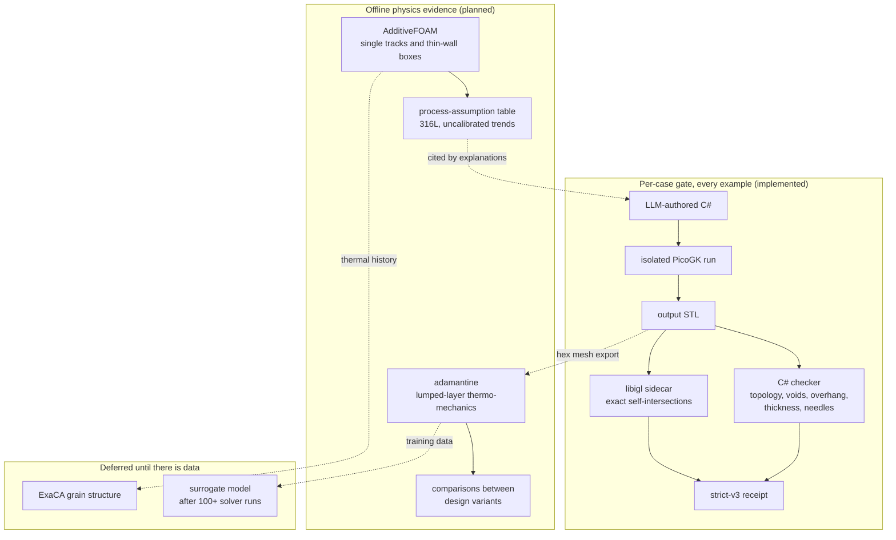
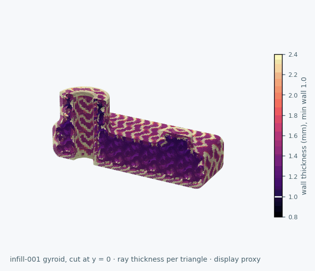
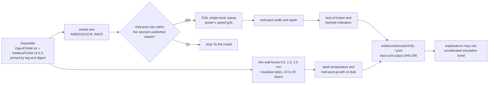
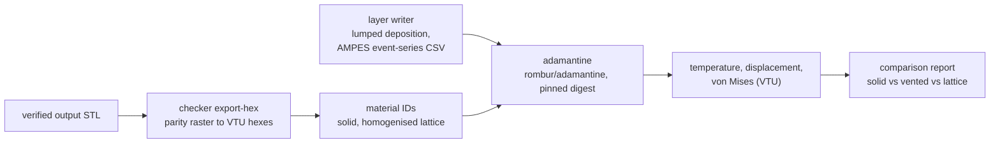

# Physics evidence plan for the DfAM corpus

The [DfAM corpus](DFAM_CODE_CORPUS.md) checks geometry: closed meshes, one
solid, trapped powder, overhang share, wall thickness and self-intersections.
Its examples also rely on stated process assumptions, such as a 1.0 mm minimum
wall and a 45 deg overhang limit, and they say plainly that residual stress,
distortion, melt-pool behaviour, microstructure and properties are not
established. This plan adds evidence in layers, from the cheapest and most
certain to the most expensive. Nothing in it is manufacturing qualification.

Seven open-source projects were reviewed on 15 October 2026 by reading their
source at the commits listed below; none was built or run for the review.
Phase 1 is implemented. Phases 2 to 4 are planned.

## Projects reviewed

| Project | What it is | Licence | Fits our hardware | Role |
|---|---|---|---|---|
| [AdditiveFOAM](https://github.com/ORNL/AdditiveFOAM) @ 8314d3c | Melt-pool and track-scale heat and fluid flow on OpenFOAM-14; calibrated to NIST AM-Bench IN625 single tracks | GPL-3.0 | Yes: Ubuntu 24.04 apt build, as in its CI | **Phase 2**: process-assumption evidence |
| [adamantine](https://github.com/adamantine-sim/adamantine) @ 5aca53e | Part-scale thermal and one-way-coupled J2 thermo-elasto-plasticity on deal.II | Apache-2.0 WITH LLVM-exception | Yes: `rombur/adamantine` Docker image | **Phase 3**: comparisons between design variants |
| [AMPES](https://github.com/Computational-Mechanics-Materials-Lab/AMPES) @ dbbea4c | One Python script turning slicer G-code into laser event series for Abaqus | MIT | Yes, but quadratic and FDM-style | **Format only**: its event-series CSV |
| [ExaCA](https://github.com/LLNL/ExaCA) @ aaf79ed | Cellular-automaton grain structure | MIT | Sub-millimetre volumes only | **Deferred** |
| [MeltPoolDG](https://github.com/MeltPoolDG/MeltPoolDG) @ de5f8a0 | Two-phase melt-pool research code; geometry written in C++ | LGPL-3.0 | Full 3D physics needs a cluster | **Cite only** |
| [DeepXDE](https://github.com/lululxvi/deepxde) @ 99b66203 | Physics-informed networks and DeepONet; no STL or 3D geometry import | LGPL-2.1 | Yes, on CPU | **Deferred** until solver data exists |
| [PyMesh](https://github.com/PyMesh/PyMesh) (last commit July 2020) | Mesh processing; abandoned, does not import on Python 3.12, no licence file | none stated | No | **Not used**; libigl replaces it |

316L stainless steel is the only alloy shipped by AdditiveFOAM, ExaCA and
adamantine alike, and it is also the test material of Kokkonen et al. (2016)
and Cloots et al. (2013), which the corpus already cites. It is the reference
alloy for Phases 2 and 3; AlSi10Mg follows.

## Phase 1: close the checker gaps (implemented)

The corpus guide listed self-intersections and actual wall thickness as things
the checker did not establish. Policy `dfam-strict-v3` measures both, using
trusted code that reads only the output STL.

- **Self-intersections:** libigl 2.6.3 `find_self_intersections` (AABB tree,
  exact predicates), installed from hash-pinned wheels into a separate
  environment. It takes 5 to 9 s on the 1.3-million-triangle gyroid.
- **Wall thickness:** a ray from every triangle's centroid along the inward
  normal, measured on the mesh rather than the 0.3 mm voxels. A plate of
  0.6 mm measures 0.6 mm in the self-test.
- **Needle triangles:** distinct vertices with a height below 1e-3 of the
  longest edge.

| Case | strict-v3 | Wall thickness p01 | Area below 1.0 mm | Self-intersecting pairs |
|---|---|---:|---:|---:|
| `scan-001` | pass | ≥ 4 mm (cap) | 0 | 0 |
| `dfam-001` | pass | 3.99 mm | 0 | 0 |
| `debug-001` | pass | ≥ 4 mm (cap) | 0 | 0 |
| `infill-001` (historical) | fail | 1.05 mm | 0.37 % | 4 |

The new check found a real defect. `infill-001` contains a detached sheet of
four triangles with no volume, which every earlier check passed. The vertex
weld proposed in #6 removes that case's degenerate triangles but not this
sheet. Receipt: [strict-v3-20261015.json](../evidence/dfam-code/strict-v3-20261015.json).

## Phase 2: back the process assumptions with AdditiveFOAM (planned, 3 to 5 days)

AdditiveFOAM solves heat transfer and melt flow around a moving beam in a
millimetre-scale box. It cannot read our STL files, and it has no solid
mechanics. It can, however, turn "1.0 mm minimum wall" from an unsupported
number into a documented, reproducible trend for one alloy and parameter set.

1. **Container.** Our own Dockerfile installs OpenFOAM-14 from the OpenFOAM
   Foundation packages and builds AdditiveFOAM at the v2.0.0 tag. Its GPL
   source, material files and tutorials are referenced by tag and hash,
   never copied into this Apache-2.0 repository.
2. **Smoke test.** Reproduce the AM-Bench IN625 tutorial (Knapp et al. 2023)
   and compare melt-pool length, width and depth with the values it reports.
3. **316L single-track sweep.** About 25 runs over power and speed, giving
   melt-pool width and depth. From these come a lack-of-fusion indicator (depth
   against layer thickness, hatch overlap) and a keyhole indicator (depth over
   width).
4. **Thin-wall boxes.** Walls 0.6, 1.0 and 2.0 mm wide with insulated sides,
   10 to 20 layers each, compared with bulk material for heat build-up.
5. **Publication.** A process-assumption table in `evidence/process/`, with
   every input and output hashed, plus bibliography entries for AdditiveFOAM
   (JOSS, doi:10.21105/joss.07770), its heat-source model (Coleman et al. 2024)
   and the AM-Bench calibration (Knapp et al. 2023).

**Acceptance:** the smoke test matches the tutorial; every published number
has a hashed input and output; the table says "uncalibrated for any given
machine". **Limits:** powder is a continuum, the free surface is flat and
absorption is assumed, so this cannot predict dross, roughness or whether a
particular machine prints a 1.0 mm wall.

## Phase 3: compare design variants with adamantine (planned, 1 to 2 weeks)

adamantine is the only reviewed code that predicts part-scale temperature,
displacement and stress. Simulating every laser track of a 70 x 44 x 30 mm
part is out of reach on any hardware, but lumped layers about 1 mm thick on a
0.5 mm hex mesh take hours per design on 16 cores.

1. **Image.** Pin `rombur/adamantine` by digest and run a shipped example.
2. **Mesh.** A new `export-hex` mode in the checker writes its existing
   occupancy raster as a hexahedral VTU mesh. Lattice regions get one
   homogenised material: 1 mm gyroid walls cannot be resolved at part scale.
3. **Deposition.** A small writer produces lumped layers, and per-track paths
   in AMPES's event-series format (time, x, y, z, power) for later track-level
   runs.
4. **Studies.** Solid, vented and lattice variants of `dfam-001` and
   `infill-001`: displacement and stress hot spots near overhangs and
   channels, read as comparisons between variants, not as predictions.
5. **First, confirm two suspected upstream bugs** found by reading the code:
   the von Mises formula appears to count one shear term twice and omit
   another, and the cooling rate appears to be missing parentheses. If they
   are real, report them upstream before relying on either output.

**Acceptance:** the shipped example reproduces; mesh export round-trips the
part volume within 1 %; results are labelled as comparisons. **Limits:** no
build-plate removal step, temperature-independent yield strength, no melt-pool
physics, and not fast enough to score every generated design.

## Phase 4: deferred until there is a reason

- **Surrogate model.** Only after 100 or more validated solver runs. Start with
  a Gaussian process or a small network mapping feature parameters (wall
  thickness, overhang angle, channel size) to a thermal or distortion
  indicator. Use DeepONet (DeepXDE) or NVIDIA PhysicsNeMo only for field
  outputs. A forward physics-informed network for moving laser sources is not
  recommended: the length and time scales span several decades.
- **ExaCA.** Grain texture of a 1 mm wall against bulk material, from
  AdditiveFOAM thermal histories, only if a corpus claim comes to depend on
  microstructure. It cannot judge printability or overhangs.
- **MeltPoolDG.** Cite its papers in the limits; its full 3D physics needs a
  cluster and its geometry is written in C++.
- **PyMesh.** Not used. libigl covers self-intersections; pytetwild or Gmsh
  cover tetrahedral meshing if CalculiX is used later.

## Ground rules

- Physics results live in their own evidence files with SHA-256-bound inputs
  and outputs. They never change a per-case pass or fail.
- Nothing is described as qualification. Simulations here are uncalibrated
  for any particular machine unless a calibration is published with them.
- GPL and LGPL code is run as separate tools, never vendored. Shipping a
  built image would carry source-offer obligations.
- Everything runs on the Linux verification host (16 cores, 15 GB, Docker,
  no GPU). The Mac stays dedicated to MLX training.
