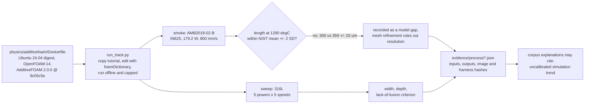
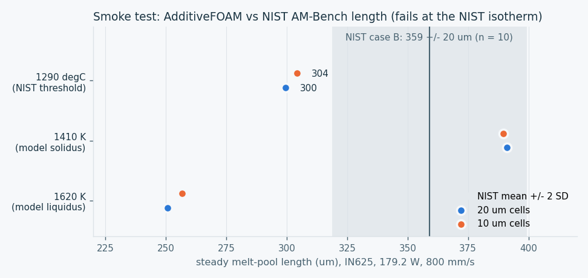
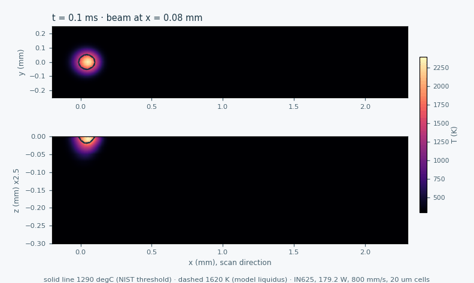
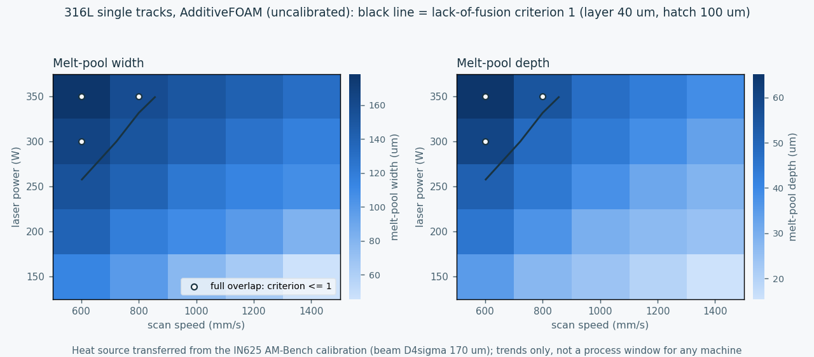

# Process simulation with AdditiveFOAM (Phase 2)

Phase 2 of the [physics evidence plan](PHYSICS_EVIDENCE_PLAN.md) runs
[AdditiveFOAM](https://github.com/ORNL/AdditiveFOAM) single tracks to put
simulation numbers next to the corpus's process assumptions. This page
records what was run, what matched a measurement, what did not, and what the
numbers may and may not be used for.

**Status, 15 October 2026:**
- The pinned container is built.
- The AM-Bench smoke test runs and is mesh-converged, but **it does not
  reproduce NIST's measured melt-pool length within its acceptance band**.
- The 316L power-speed sweep is complete and published as an uncalibrated
  trend.
- The thin-wall heat build-up study is still to do.

None of this is process qualification.



## Container

`physics/additivefoam/Dockerfile` builds OpenFOAM-14 (`openfoam14
20261008` from the OpenFOAM Foundation packages, key checked by SHA-256) and
AdditiveFOAM at the 2.0.0 release commit `9c05c5eb54db03faa342b14b0806efe740de8c44`,
on Ubuntu 24.04 pinned by digest. The image is built locally and never
published, because OpenFOAM and AdditiveFOAM are GPL-3.0; their sources are
fetched at build time and nothing from them is copied into this repository.

`physics/additivefoam/run_track.py` runs every case with Docker's network
disabled, a read-only root, all capabilities dropped, 12 GB of memory, 8 CPUs
and a process limit, as the invoking user. It starts from the upstream
`AMB2018-02-B` tutorial inside the image, writes a new scan path, swaps the
material include and sets entries with OpenFOAM's `foamDictionary`. Each
receipt binds the image ID, the AdditiveFOAM commit, the Dockerfile and
harness hashes, a hash of each case's `0/`, `constant/` and `system/`
directories, and the melt-pool CSV hashes.

## Smoke test against NIST AM-Bench

The tutorial is AdditiveFOAM's single track calibrated by Knapp et al. (2023,
doi:10.1016/j.commatsci.2022.111904) to the AMB2018-02 case B condition: IN625
bare plate, 179.2 W true power, 800 mm/s, constant absorptivity 0.33 and a
Gaussian source with an 85 um second-moment radius. NIST's AMMT measured a
melt-pool length of **359 +/- 20 um** (n = 10) by in-situ thermography, with
the melt-pool edges defined at a solidus of 1290 degC
([CHAL-AMB2018-02-MP-Length](https://www.nist.gov/ambench/chal-amb2018-02-mp-length),
[AMB2018-02 description](https://www.nist.gov/ambench/amb2018-02-description)).

The acceptance criterion, set before the run, was a simulated steady length
at the same 1290 degC isotherm within the measured mean +/- 2 SD.



| Isotherm | 20 um cells | 10 um cells | NIST |
|---|---:|---:|---:|
| 1290 degC = 1563 K (NIST threshold) | **300 um** | **304 um** | 359 +/- 20 um |
| 1410 K (model solidus) | 391 um | 389 um | |
| 1620 K (model liquidus) | 251 um | 257 um | |

Steady values are averaged while the beam crosses the middle of the 2 mm
track (0.8 to 1.8 mm); the melt pool settles within about 0.7 ms and varies by
under 1.5 um within that window. Halving the cell size changes the length by
about 1 % and the width by 4 %, so mesh resolution does not explain the gap.

**Result: the smoke test fails its acceptance criterion.** At the same
temperature as the measurement, the model's melt pool is about 15 % shorter
than NIST's. The model's own IN625 solidus (1410 K) is 153 K below NIST's
1290 degC, and at that isotherm the length falls inside the band. That
observation was made after the run, so it is not used to claim agreement. Two
explanations are possible but not established here. First, the calibration
may have targeted other quantities, such as the cross-section width and depth
in Lane et al. (2020, doi:10.1007/s40192-020-00169-1), which were not
transcribed for this comparison. Second, the thermographic length carries its
own emissivity and threshold uncertainty. Comparing width and depth against
those tables is the next validation step.



The animation shows the top surface and the centre section (depth scale
stretched 2.5 times) of the 20 um case, every 0.1 ms. The solid contour is
NIST's 1290 degC threshold; the dashed contour is the model liquidus.

## 316L single-track sweep (uncalibrated)

The same tutorial source (absorptivity 0.33, 85 um second-moment radius, that
is a D4sigma beam of 170 um) was run with AdditiveFOAM's SS316L material for
five powers and five speeds over a 2 mm track. **The heat source was
calibrated for IN625 on NIST's testbed and is transferred to 316L without any
calibration.** The beam is also wider than in most commercial machines, which
makes the melt pools shallower. The 25 runs took 402 s of solver time.



The black line marks the lack-of-fusion criterion of Tang, Pistorius and
Beuth (2017, Additive Manufacturing 14, 39-48): with hatch spacing h, layer
thickness L, melt-pool width W and depth D, full overlap needs
(h/W)^2 + (L/D)^2 <= 1. The assumed layer is 40 um and the hatch 100 um.
The depth-to-width ratio stays at or below 0.37, inside the conduction
regime. That matters, because AdditiveFOAM has no vapour, recoil or keyhole
physics.

| Power (W) | Speed (mm/s) | Width (um) | Depth (um) | Depth / width | Lack-of-fusion criterion |
|---:|---:|---:|---:|---:|---:|
| 150 | 600 | 113 | 35 | 0.31 | 2.09 |
| 150 | 800 | 98 | 27 | 0.28 | 3.17 |
| 150 | 1000 | 77 | 24 | 0.31 | 4.47 |
| 150 | 1200 | 64 | 20 | 0.30 | 6.59 |
| 150 | 1400 | 46 | 15 | 0.34 | 11.57 |
| 200 | 600 | 139 | 45 | 0.32 | 1.31 |
| 200 | 800 | 118 | 37 | 0.31 | 1.88 |
| 200 | 1000 | 109 | 30 | 0.27 | 2.67 |
| 200 | 1200 | 98 | 27 | 0.27 | 3.26 |
| 200 | 1400 | 82 | 25 | 0.30 | 4.13 |
| 250 | 600 | 153 | 51 | 0.34 | 1.03 |
| 250 | 800 | 140 | 44 | 0.32 | 1.33 |
| 250 | 1000 | 123 | 38 | 0.31 | 1.77 |
| 250 | 1200 | 114 | 32 | 0.28 | 2.33 |
| 250 | 1400 | 107 | 28 | 0.27 | 2.87 |
| 300 | 600 | 165 | 60 | 0.36 | **0.81** |
| 300 | 800 | 151 | 48 | 0.32 | 1.12 |
| 300 | 1000 | 140 | 44 | 0.31 | 1.34 |
| 300 | 1200 | 127 | 38 | 0.30 | 1.70 |
| 300 | 1400 | 117 | 33 | 0.28 | 2.17 |
| 350 | 600 | 178 | 65 | 0.37 | **0.69** |
| 350 | 800 | 158 | 55 | 0.35 | **0.93** |
| 350 | 1000 | 150 | 47 | 0.31 | 1.17 |
| 350 | 1200 | 141 | 43 | 0.31 | 1.36 |
| 350 | 1400 | 130 | 39 | 0.30 | 1.66 |

What this supports: monotonic trends (deeper and wider pools with more power
and less speed), and the observation that with this wide beam only the
highest energy inputs give full overlap at 40 um layers and 100 um hatch.
What it does not support: a process window for any machine, the absolute
widths and depths (the reference case is 15 % short in length), or any claim
that a 1.0 mm wall prints. A 1.0 mm wall would be several of these tracks
wide, which is a geometric sanity bound only.

## What remains for Phase 2

1. Compare width and depth with Lane et al. (2020) for cases A, B and C, the
   quantities a calibration would normally target.
2. Thin-wall heat build-up: 0.6, 1.0 and 2.0 mm walls with insulated sides
   over 10 to 20 layers, using AdditiveFOAM's multi-layer workflow.
3. Add AdditiveFOAM (JOSS, doi:10.21105/joss.07770), Knapp et al. (2023) and
   Tang et al. (2017) to `data/dfam-code/bibliography.json` once a corpus
   explanation cites these results.

## Reproduce

```sh
docker build -t qwen-picogk/additivefoam:2.0.0-9c05c5e physics/additivefoam
python3 physics/additivefoam/run_track.py smoke --out work/process/smoke-NEW \
  --receipt work/process/smoke-NEW.json
python3 physics/additivefoam/run_track.py smoke --refine 2 --out work/process/smoke-10um-NEW \
  --receipt work/process/smoke-10um-NEW.json
python3 physics/additivefoam/run_track.py sweep --out work/process/sweep-NEW \
  --receipt work/process/sweep-NEW.json
python3 physics/additivefoam/render_figures.py --smoke20 ... --smoke10 ... \
  --sweep ... --case work/process/smoke-NEW/amb2018-02-b --out docs/visuals/NEW-DIR
```

The harness refuses existing output directories and receipt paths. The
image needs network access only while it is built.
