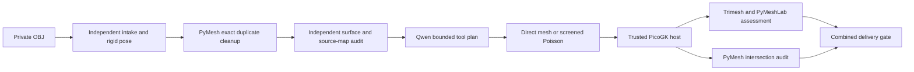

# PyMesh in the scan-to-PicoGK chain

The demo now requires a separately pinned **PyMesh 0.3** runtime. PyMeshLab
continues to perform screened Poisson reconstruction, Trimesh and PyMeshLab
continue to check geometry, and PyMesh adds exact mesh cleanup and a separate
native-STL self-intersection audit. The Qwen adapter and its bounded JSON
contract are unchanged. This integration does not train Qwen on PyMesh APIs
or introduce a raw-scan encoder.



## Runtime and installation

Use the [upstream PyMesh image](https://pymesh.readthedocs.io/en/latest/installation.html#docker),
not an unrelated package with a similar name. The tested runtime is Linux
amd64, PyMesh 0.3, Python 3.6.11, pinned by content digest:

```sh
docker pull --platform linux/amd64 \
  pymesh/pymesh@sha256:ecf699d33793efe612b66c36b2a7d3954085af55999cc3f631748fcf1671eb4e
```

The launcher checks both this local image and the existing geometry image
against `config/scan-demo.json`; it does not silently pull or replace either.
The legacy Python runtime stays inside Docker. Our pinned MLX Python 3.12
environment is unchanged. On Apple silicon, this image runs under amd64
emulation. The upstream runtime's redistribution licence has not been
established here; it remains external, with the status recorded in `NOTICE`.

PyMesh processes run without networking, with a read-only root filesystem,
dropped capabilities, no new privileges, a 128-process limit, four CPUs,
4 GiB of memory with no additional swap, and a private temporary filesystem.
Only integration scripts are mounted read-only and the private run directory
is writable. No host credentials are supplied. The older, separate geometry
worker retains its existing execution settings; these restrictions describe
the new PyMesh worker specifically.

## Exact cleanup and independent validation

`scripts/scan_pymesh.py prepare` operates on the hash-bound prepared NPZ:

1. `remove_duplicated_vertices(..., 0.0)` merges exactly coincident positions.
2. `remove_duplicated_faces` removes duplicate triangles.
3. `remove_isolated_vertices` discards vertices unused by retained faces.

The [upstream operations](https://pymesh.readthedocs.io/en/latest/mesh_processing.html)
provide index maps, which the worker composes into prepared-intake vertex/face
indices (after the existing intake's zero-area-face removal, not raw OBJ face
numbers). Zero tolerance is deliberate: no unmeasured welding distance is
chosen for the scan. No remeshing, smoothing, hole filling, near-vertex merge
or self-intersection resolution is applied in this stage.

The separate geometry worker's `pymesh_intake` stage then verifies hashes,
finite arrays, valid indices, exact unchanged vertex coordinates, retained
oriented triangle correspondence and complete original geometric-face coverage.
It recomputes boundary/non-manifold edges, components and winding before
Qwen sees the cleaned counts. Missing acquired triangles, moved vertices,
orientation changes or duplicate faces cause refusal. Opposing duplicate
faces can cancel in PyMesh; the independent coverage check rejects lost
surface, and an entirely removed surface is refused immediately.

Original intake files remain unchanged. The cleaned intake and source maps
are separate private artifacts. Original zero-area faces removed by the
existing intake remain recorded there. Exact cleanup does not establish
correct registration, units, physical completeness or scan accuracy.

## Native STL audit and delivery

After each native PicoGK result, PyMesh reads the hash-bound STL and uses
`detect_self_intersection`. STL triangle-soup vertices are welded exactly for
adjacency during this audit; the STL itself is never rewritten. PyMesh reports
intersection-pair counts separately from PyMeshLab's selected-face counts.
They are different metrics and must not be equated.

`combined-quality.json` binds the unchanged existing assessment to the PyMesh
audit of the **same native STL**. Delivery requires both sets of checks to
pass. The one existing demo-envelope retry is retained and its first results
remain available. Missing PyMesh, hash mismatch, API failure, timeout, memory
failure or detected intersections do not fall back to an unchecked delivery.

The default command remains:

```sh
python3.12 scan_demo.py --demo --obj /path/to/owned-scan.obj \
  --base /path/to/exact/base --output work/new-private-pymesh-run
```

The original source, numeric assumptions, old results and adapters are retained;
pre-integration source snapshots live under
`evidence/scan-demo/snapshots/pre-pymesh/`. New results identify the PyMesh image,
engine version, script hashes, cleanup counts/maps and audited native hash.
Raw scans, correspondence arrays and STL derivatives stay outside Git.

## Verification and limits

The dedicated `pymesh-engine` CI job uses the actual pinned library. It checks
exact duplicate handling, isolated vertices, provenance maps, input tampering,
opposing duplicate refusal, a clean tetrahedron, and deliberately intersecting
triangles. Separate geometry-runtime tests reject movement, missing surface,
changed winding, invalid source indices and retained duplicate faces.

The [integration receipt](../evidence/scan-demo/pymesh-integration-20261015.json)
records a complete synthetic run with our actual Qwen adapter and native
PicoGK: a 13-face input with an exact duplicate becomes 12 faces, and the
unchanged delivered STL passes both assessment engines with zero PyMesh
intersection pairs. This is one exposed integration fixture, not a new model
benchmark or proof for the private fan.

A separate complete private-fan run also passed all nine combined checks:
PyMesh merged 13 exact duplicate vertices without removing faces from the
prepared intake, and detected zero intersection pairs in the delivered STL.
The first native result failed the component and reconstructed-surface checks;
the one declared demo-envelope retry passed. That retry uses the dominant
front surface (98.689% of input triangle area), omits 16,755 triangles from
the unregistered rear fragment, and adds hypothetical connections. The area
fraction is not an accuracy score. The receipt records hashes and aggregate
results; geometry and correspondence arrays remain private. Source bindings
and the delivered STL hash were verified after completion.

The receipt also records an earlier hash-mismatch refusal with no STL delivery.
The mismatch was not reproduced by isolated-stage hash-stability diagnostics
or the accepted clean run; its cause is not established. No hash gate was
relaxed or failed artifact rewritten. An exploratory fan run interrupted by
source changes was separately invalidated. The launcher now re-verifies its
registered source files before delivery so a development edit cannot silently
inherit the original source bindings.

The engine is a geometry tool, not a replacement for a reconstruction
algorithm, measured registration or independent engineering validation.
Neither exact cleanup nor a clean intersection report demonstrates fitment,
strength, fatigue, powder evacuation, metal-print qualification or safe rotor
operation. Larger private scans can exceed this worker's resource limits;
that is a failed run to investigate, not permission to weaken the gate.
