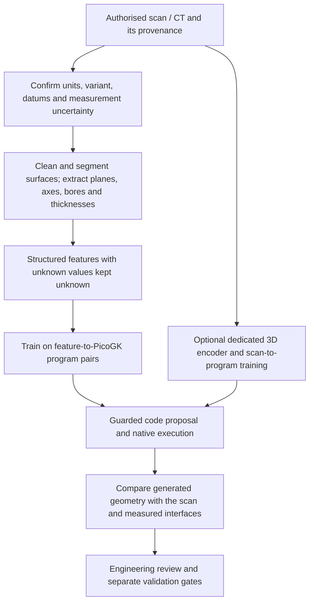

# What our model can do with a complex part or a 3D scan

## Current answer

The original release described below remains unchanged. A separate
[end-to-end OBJ-to-STL demo](OBJ_TO_STL_DEMO.md) adds typed scan analysis,
an additional tool-planning adapter and independent geometry checks. This is
a tool-assisted workflow, not raw-scan understanding inherited by this adapter.

The released adapter is a **text model**, based on `Qwen2ForCausalLM`. It has
no point-cloud/mesh encoder and was not trained on scan-to-PicoGK pairs.
`infer.py` accepts explicit numeric fields for six bounded categories; it
does not read STL, OBJ, PLY, CT volumes or arbitrary part files. Supplying a
scan filename or attaching mesh bytes does not give it 3D understanding.

The 54/60 score is about small synthetic parameter plans. It does not establish
reverse engineering, general C# generation or reconstruction of a Porsche
part. A prompt containing extracted geometric facts is a different task from
directly consuming the scan.

## Two actual C# probes, same released adapter

### More demanding catalogue concept: rejected

We selected the existing
[stationary cold-side diffuser concept](https://github.com/cluster2600/porscheparts/blob/f1d60927c25ff01d395699c5014d379f3c8c4f45/parts/993-turbocharger-k16-cold-side-prototype/source/cold_side_concept.scad)
from the K16 study. It has a tapered hollow shell, a 50-to-68 mm bore over
90 mm, 4 mm radial wall thickness and two unequal flange rings. These are
owner-declared design variables, **not measured K16 dimensions**.

The prompt supplied the `BaseCone`, `BasePipe`, `LocalFrame`, `Vector3`,
`BoolSubtract` and `BoolAdd` API contracts and requested literal C# statements.
Our adapter produced unsupported `CreateRadiusAttr`/`AddPipe` calls, repeated
them and exhausted 1,024 output tokens without EOS. The answer was rejected
and **never compiled or executed**. No repaired or manually authored model
result is substituted. The complete
[failed transcript](visuals/advanced/diffuser-rejected.json) remains visible.

One failed probe is not a universal impossibility result. It is direct
evidence that this release cannot presently claim reliable reconstruction of
that concept, even from explicit dimensions rather than a noisy scan.

### Within the trained C# subset: a real nonplanar tapered spaceframe


For a more complex successful example we used a synthetic four-node,
six-edge nonplanar truss, motivated by structural-carrier studies. The nodes
are deliberately designed coordinates, not measured `993-ENG-CARRIER-0001`
interfaces. Each rounded beam tapers from diameter 3 mm to diameter 5 mm.

Our adapter emits **six actual C# `lattice.AddBeam` statements**, converting
the diameters to radii 1.5 and 2.5 mm and preserving every endpoint. A strict
literal-only parser independently checks the exact required graph, refuses
extra APIs/code, duplicates, wrong dimensions and missing EOS, then permits
those statements in a trusted PicoGK wrapper. The returned code is unchanged:
no repair, completion or another model is used.

The admitted model statements compile and execute with PicoGK 2.3.0. The
native screen records positive volume **1,960.0616 mm³**, **22,232 triangles**,
equal STL roundtrip triangle count and all six required beam midpoints inside.
Compilation has zero errors/warnings. These are limited geometry screens,
not strength, load-path, attachment, fatigue or manufacturing qualification.

- [Actual model C#](visuals/advanced/spaceframe/response.cs.txt)
- [Raw prompt/response and admission record](visuals/advanced/spaceframe/llm.json)
- [Trusted wrapper including the admitted statements](visuals/advanced/spaceframe/VerifiedHost.cs.txt)
- [Native STL](visuals/advanced/spaceframe/raw.stl) and
  [metrics](visuals/advanced/spaceframe/native.json)

The generic qualified CLI remains the six-category JSON planner. This separate
probe demonstrates a restricted older coding capability; it does not promote
arbitrary model C# into executable production code.

## What is needed for genuine scan-to-code



The smallest practical next route is **scan → verified geometric features →
C#**, before attempting end-to-end raw-scan learning. A useful first curriculum
would add tapered shells, flange bores, bolt patterns, unions/subtractions,
local frames and API-error/refusal examples, all with independent native
checks. The rejected diffuser provides a concrete target, not a reason to
change the existing benchmark or invent missing measurements.

Reconstruction evaluation must measure alignment, surface distance,
missing/extra geometry, bore centres/axes, mating planes, wall thickness and
uncertainty in actual units. Chamfer/Hausdorff-style surface checks alone do
not establish functional interfaces or internal passages hidden from a surface
scan. Hold out complete geometry families and scan variants; avoid repeatedly
selecting on published examples. No such scan reconstruction was performed
in this release.

[CAD-Recode](https://github.com/filaPro/cad-recode) shows that a specialised
Qwen2-based model with an additional 3D projection layer can map point clouds
to **CadQuery Python**, rather than PicoGK C#. It is useful related research,
not functionality inherited by our text adapter. Its
[repository licence](https://github.com/filaPro/cad-recode/blob/main/LICENSE.md)
is CC BY-NC 4.0; none of its weights, datasets or code is imported into this
Apache-2.0 release.

## Repeat the text-only probes

```sh
.venv/bin/python scripts/probe_csharp.py \
  docs/visuals/advanced/diffuser-rejected.json work/new-diffuser-probe
.venv/bin/python scripts/probe_csharp.py \
  docs/visuals/advanced/spaceframe/llm.json work/new-spaceframe-probe
```

An existing exact pinned base can be supplied using `--base /path/to/base`.
The script always saves raw text and never executes generated code. For the
specific spaceframe, `scripts/check_beam_code.py` provides the strict admission
check. Rebuilding its supplied trusted wrapper requires a new net9.0 console
project with the existing locked PicoGK 2.3.0 package. Its first argument is
the desired STL output path. Do not compile rejected/arbitrary model output.
