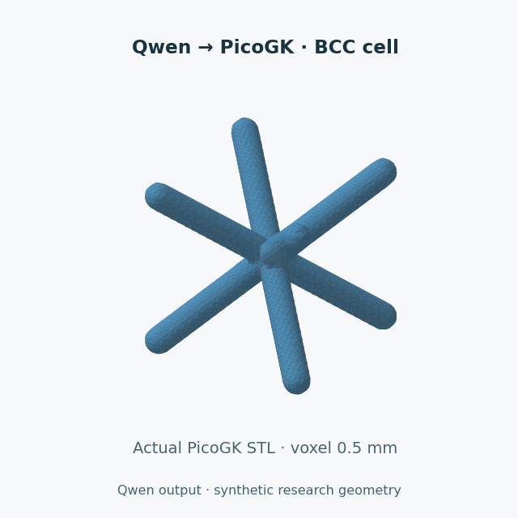
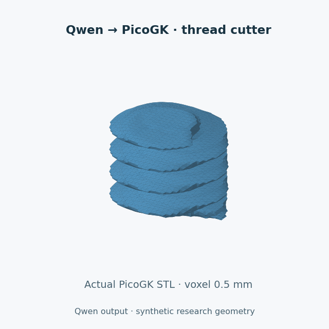
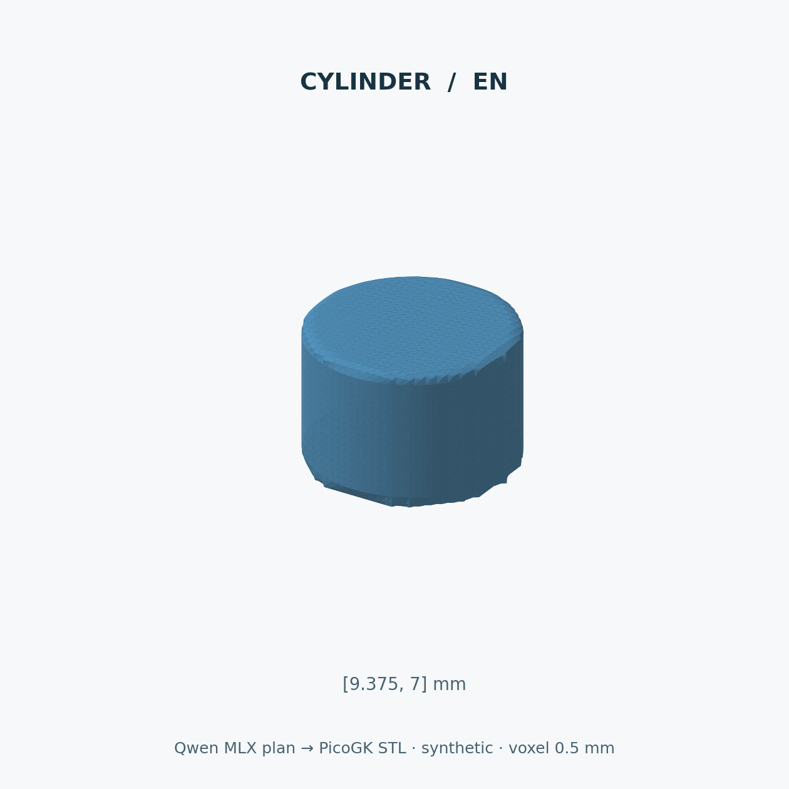
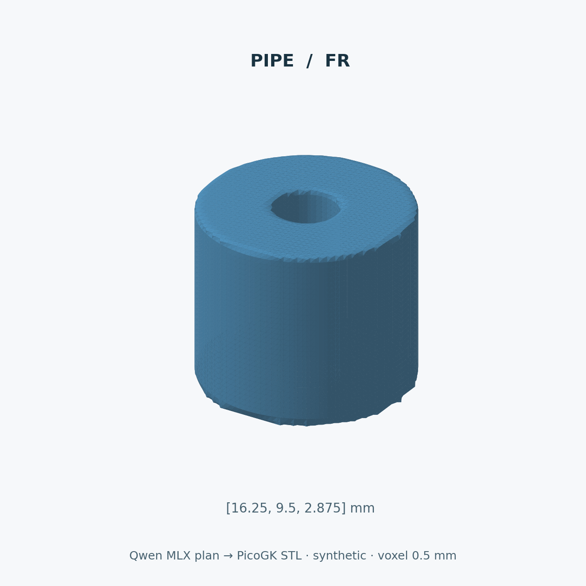
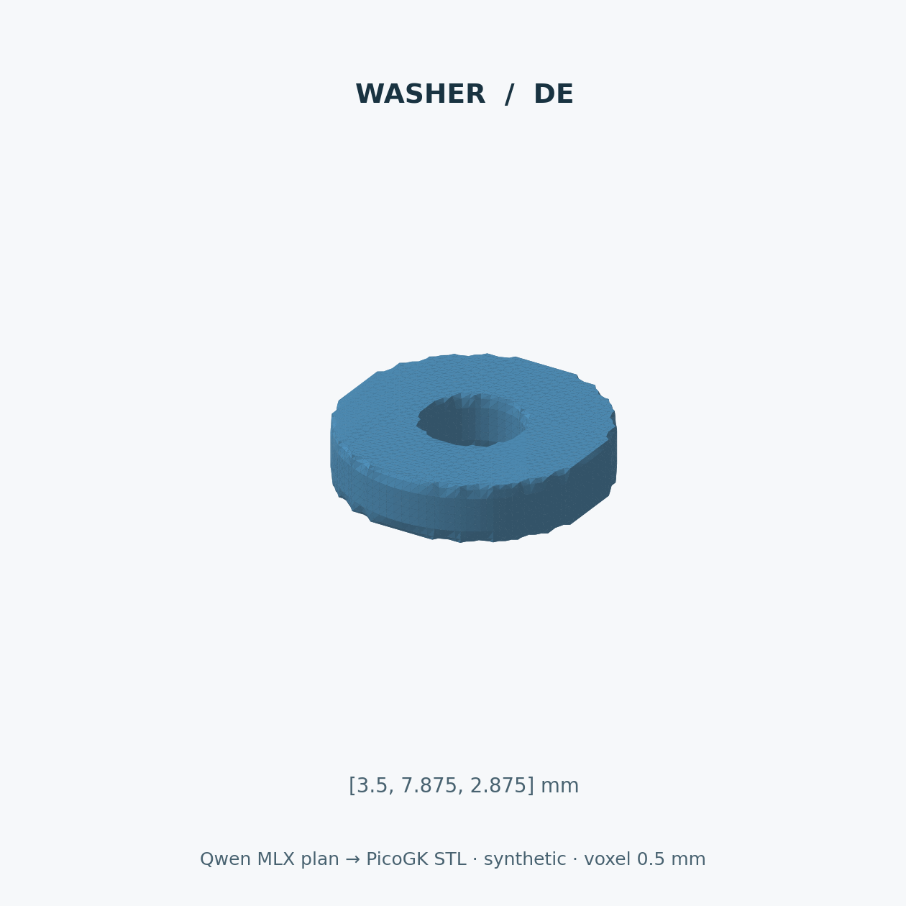
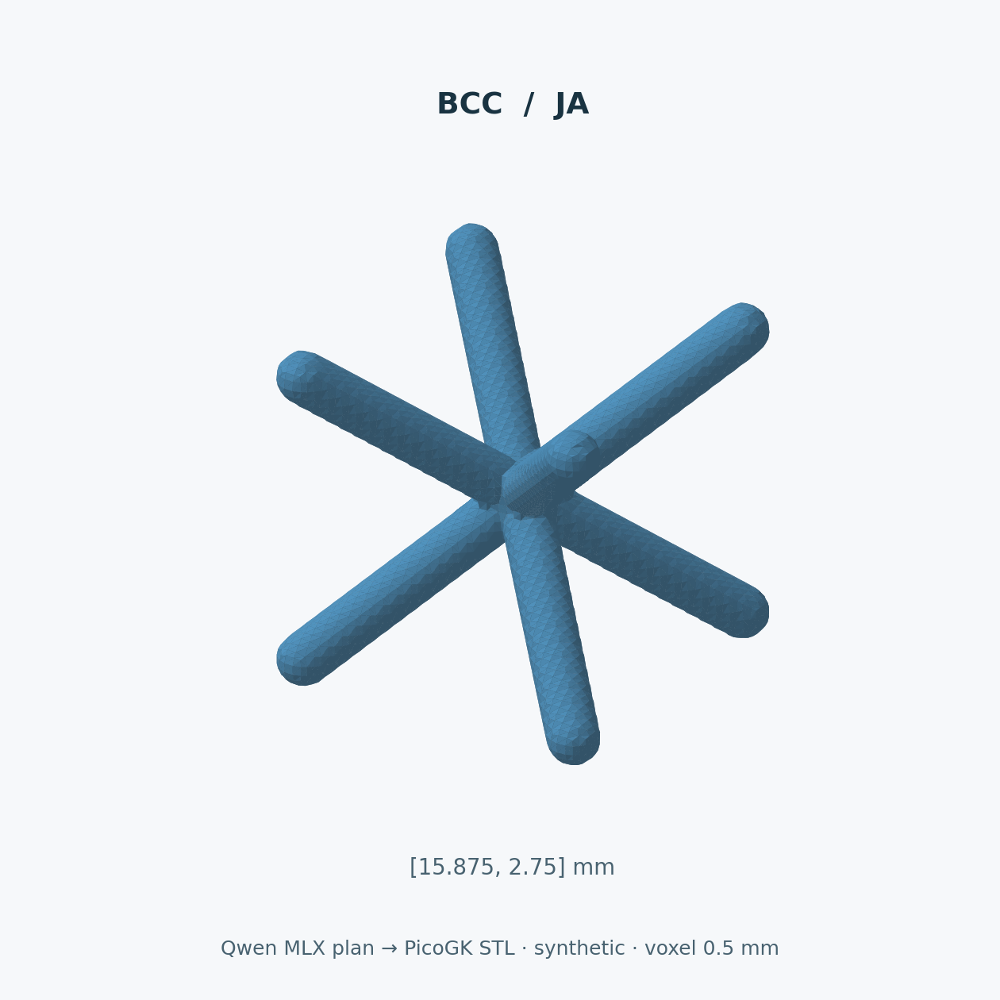
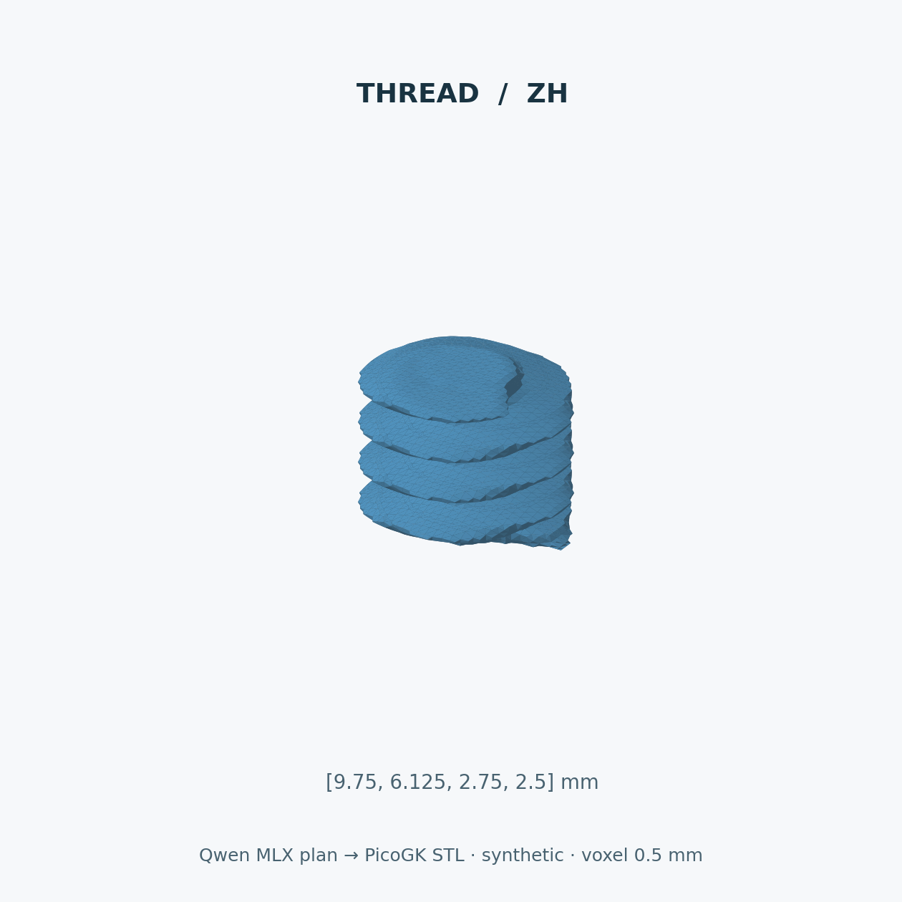
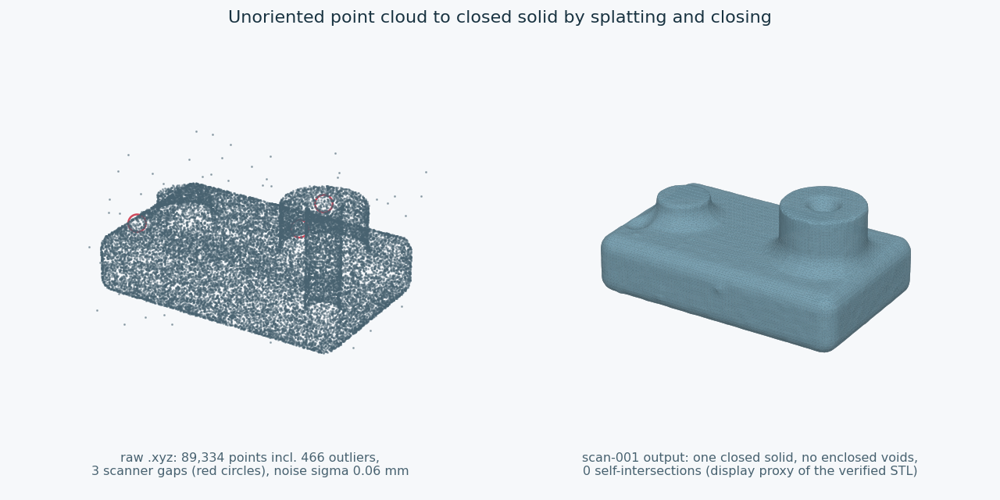
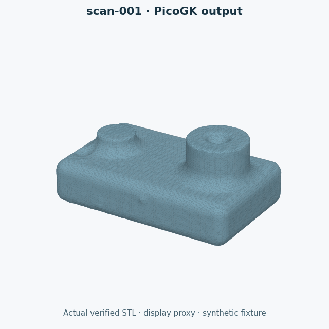

# Geometry gallery produced from our LLM's actual outputs

## Animated native meshes


| Existing model-plan example | Turntable |
|---|---|
| BCC cell |  |
| Synthetic thread cutter |  |

Each GIF rotates the actual native STL: 24 frames, 640 × 640 pixels,
120 ms per frame, continuous loop. Only the camera moves. The more complex
spaceframe is generated from our adapter's actual restricted C# output.
See [the successful code and failed catalogue-part probe](../SCAN_TO_PICOGK.md).

Recreate an animation with the existing plotting/Pillow environment:

```sh
python3 scripts/animate_mesh.py docs/visuals/generated/bcc/raw.stl work/bcc.gif --title 'Qwen → PicoGK · BCC cell'
```

Each GIF has a neighbouring JSON receipt with source-mesh,
renderer and output hashes, frame count and geometry-change status.


Five exposed final cases were selected as demonstrations, one recipe and
one language each. The pinned **project-trained Qwen adapter** was called
again on each raw multilingual request. Its exact JSON response reached EOS,
passed independent unit/quantity checks and drove the trusted PicoGK host.
The STL files below are that host's actual output at **0.5 mm voxel resolution**.

These PNGs are orthographic Matplotlib renders of the native triangles,
with one shared physical scale. They are not screenshots of PicoGK's viewer
and are not illustrations invented by an image-generation model. The geometry
is unchanged; camera centring and lighting are presentation only.

| Example | Raw request language | Actual model parameters, mm | Evidence |
|---|---|---|---|
| Cylinder | English | `[9.375, 7]` | [Response](generated/cylinder/llm.json), [STL](generated/cylinder/raw.stl), [native metrics](generated/cylinder/native.json) |
| Pipe | French | `[16.25, 9.5, 2.875]` | [Response](generated/pipe/llm.json), [STL](generated/pipe/raw.stl), [native metrics](generated/pipe/native.json) |
| Washer | German | `[3.5, 7.875, 2.875]` | [Response](generated/washer/llm.json), [STL](generated/washer/raw.stl), [native metrics](generated/washer/native.json) |
| BCC cell | Japanese | `[15.875, 2.75]` | [Response](generated/bcc/llm.json), [STL](generated/bcc/raw.stl), [native metrics](generated/bcc/native.json) |
| Synthetic thread cutter | Chinese | `[9.75, 6.125, 2.75, 2.5]` | [Response](generated/thread/llm.json), [STL](generated/thread/raw.stl), [native metrics](generated/thread/native.json) |

Ordered quantities are defined in the [recipe contract](../../README.md#what-is-supported).
The BCC beam parameter is a **diameter**, unlike the stored radial parameters
of pipe/washer/thread. The thread cutter is not a manufactured thread standard.

## Individual views











## Reproduce the gallery

Use the pinned inference runtime and selected planner release asset, then
build the native host as described in [training/reproduction](../TRAINING.md).

```sh
.venv/bin/python scripts/build_gallery.py --output work/new-gallery
python3 scripts/render_gallery.py work/new-gallery
```

The renderer uses the existing scientific Python environment: Matplotlib
3.10.8 and NumPy 2.2.6 for the published images. It is separate from the MLX
runtime, so inference requirements do not gain plotting dependencies.
An existing exact base can be passed to the builder with `--base /path/to/base`.
Output directories are never reused; retain failed runs and their diagnostics.

[gallery.json](generated/gallery.json) records selected IDs, the adapter/base
pin, raw-input mode, native dimensions/volume/triangles and SHA-256 bindings
for model responses, requests, plans, meshes and images. It also identifies
the rendering engine and source files. The [Mermaid diagrams](../ARCHITECTURE.md)
show the relationship between these records.

The images show bounded synthetic recipes, not measured Porsche components,
optimised engineering designs or manufacturing-qualified parts. A good-looking
image adds no strength, fitment or process qualification evidence.

## DfAM corpus checker figures

These figures show **corpus teacher programs**, not Qwen outputs. Each one is
rendered from an output STL verified under `dfam-strict-v3`
([receipt](../../evidence/dfam-code/strict-v3-20261015.json)), and each has a
neighbouring JSON receipt with source, renderer and image hashes. Dense meshes
are drawn through a vertex-clustering display proxy that the receipt records;
the verified geometry itself is not edited.

| Figure | Shows |
|---|---|
|  | Section at x = 0 of `dfam-001` and its round-roof negative control; red facets face down flatter than 45 deg |
|  | The detached zero-volume sheet in `infill-001` that only the exact self-intersection check reports |
|  | Ray wall thickness of the cut gyroid in `infill-001` ([turntable](dfam/infill-thickness-turntable.gif)) |
|  | Raw synthetic scan and the `scan-001` reconstruction ([turntable](dfam/scan-001.gif)) |



Regenerate after a verification run. The checker's optional fifth argument
writes the per-triangle thickness dump; the script refuses to overwrite
existing figures:

```sh
dotnet work/dfam-checker/Checker.dll check work/dfam-runs/TAG/CASE/part.stl \
  work/dfam-fixtures/fixtures.json 0.3 1.0 work/thickness/CASE.bin
python3 scripts/render_dfam_figures.py --dumps work/thickness \
  --fixtures work/dfam-fixtures --out docs/visuals/NEW-DIR
```

The script needs numpy, matplotlib 3.10 and Pillow 11.
